# Kapitel 5: Antennenformen und Abstrahlung

## Lernziele

Nach diesem Kapitel solltest du:

- die wichtigsten Antennenformen im Amateurfunk erkennen und grundsätzlich erklären können
- Rundstrahl- und Richtantennen unterscheiden können
- verstehen, was ein Strahlungsdiagramm darstellt
- Hauptkeule, Nebenkeulen und Rückkeule erkennen können
- Antennengewinn richtig einordnen können
- dBi und dBd unterscheiden können
- das Vor-Rück-Verhältnis erklären können
- den 3-dB-Öffnungswinkel einer Richtantenne verstehen
- horizontal und vertikal polarisierte Antennen unterscheiden können
- Halbwellendipol, Groundplane und Faltdipol erklären können
- das Grundprinzip einer Yagi-Antenne verstehen
- die HB9CV-Antenne grundsätzlich einordnen können
- Quad, Magnetic Loop, Parabolantenne, Hornantenne und Helix erkennen können
- erklären können, weshalb unterschiedliche Antennenformen für unterschiedliche Aufgaben geeignet sind
- Richtwirkung, Gewinn, Wirkungsgrad und Anpassung voneinander unterscheiden können

> **Hinweis zu HB3 und HB9:**
> Das BAKOM verlangt Kenntnisse von Antennentypen und Antenneneigenschaften. Für HB3 sind die technischen und rechnerischen Fragen weniger komplex als für HB9. Die Kennzeichnung **HB9-Vertiefung** dient in diesem Lehrwerk als Lernhilfe und stellt keine offizielle Einzelabgrenzung des Prüfungsstoffes dar.

## Formelzeichen und Symbole

<table>
<thead>
<tr>
<th>Zeichen</th>
<th>Bedeutung</th>
<th>Einheit</th>
</tr>
</thead>
<tbody>
<tr>
<td>\(\lambda\)</td>
<td>Wellenlänge</td>
<td>m</td>
</tr>
<tr>
<td>\(G\)</td>
<td>Antennengewinnfaktor</td>
<td>keine</td>
</tr>
<tr>
<td>\(g\)</td>
<td>Antennengewinn</td>
<td>dB</td>
</tr>
<tr>
<td>\(g_i\)</td>
<td>Gewinn bezogen auf den Isotropstrahler</td>
<td>dBi</td>
</tr>
<tr>
<td>\(g_d\)</td>
<td>Gewinn bezogen auf den Halbwellendipol</td>
<td>dBd</td>
</tr>
<tr>
<td>\(P\)</td>
<td>Leistung</td>
<td>W</td>
</tr>
<tr>
<td>\(\theta\)</td>
<td>Winkel</td>
<td>°</td>
</tr>
</tbody>
</table>

Der griechische Buchstabe:

\[
\lambda
\]

wird **Lambda** ausgesprochen.

Der griechische Buchstabe:

\[
\theta
\]

wird **Theta** ausgesprochen und kann einen Winkel bezeichnen.

## Der rote Faden

Eine Antenne kann die zugeführte Energie sehr unterschiedlich im Raum verteilen.

Eine Antenne kann beispielsweise:

**möglichst gleichmässig rundum**

oder:

**bevorzugt in eine bestimmte Richtung**

abstrahlen.

Diese räumliche Verteilung bezeichnet man als:

**Strahlungscharakteristik**

beziehungsweise:

**Strahlungsdiagramm**

Daraus ergeben sich wichtige Begriffe wie:

- Richtwirkung
- Antennengewinn
- Hauptkeule
- Nebenkeulen
- Rückkeule
- Vor-Rück-Verhältnis
- Öffnungswinkel

Dieses Kapitel verbindet deshalb:

**Antennenform → Stromverteilung → Strahlungsdiagramm → praktische Anwendung**

---

# Das Strahlungsdiagramm

Ein Strahlungsdiagramm zeigt, wie stark eine Antenne elektromagnetische Energie in verschiedene Richtungen abstrahlt.

Beim Empfang kann dasselbe Diagramm grundsätzlich auch als Richtempfindlichkeit der Antenne verstanden werden.

Das Diagramm zeigt nicht:

**wie die Funkwelle räumlich aussieht**

sondern:

**wie stark die Antenne in verschiedene Richtungen wirkt.**

---

# Horizontales und vertikales Strahlungsdiagramm

Ein dreidimensionales Strahlungsfeld lässt sich häufig durch zwei Schnitte darstellen.

## Horizontaldiagramm

Blick von oben auf die Antenne.

Es zeigt, wie die Antenne in verschiedene Himmelsrichtungen abstrahlt.

## Vertikaldiagramm

Seitlicher Schnitt.

Es zeigt insbesondere:

- Abstrahlwinkel
- Energie zum Horizont
- Energie nach oben

Für Kurzwellen-DX ist das Vertikaldiagramm besonders wichtig.

---

# Der Halbwellendipol

Der Halbwellendipol wurde bereits in Kapitel 4 eingeführt.

Seine Gesamtlänge beträgt ungefähr:

\[
\frac{\lambda}{2}
\]

Der klassische mittengespeiste Dipol besitzt zwei gleich lange Schenkel.

Beim freien horizontalen Dipol ist die Abstrahlung:

**quer zur Drahtachse am stärksten**

und:

**in Verlängerung des Drahtes sehr schwach beziehungsweise idealisiert null.**
.
.

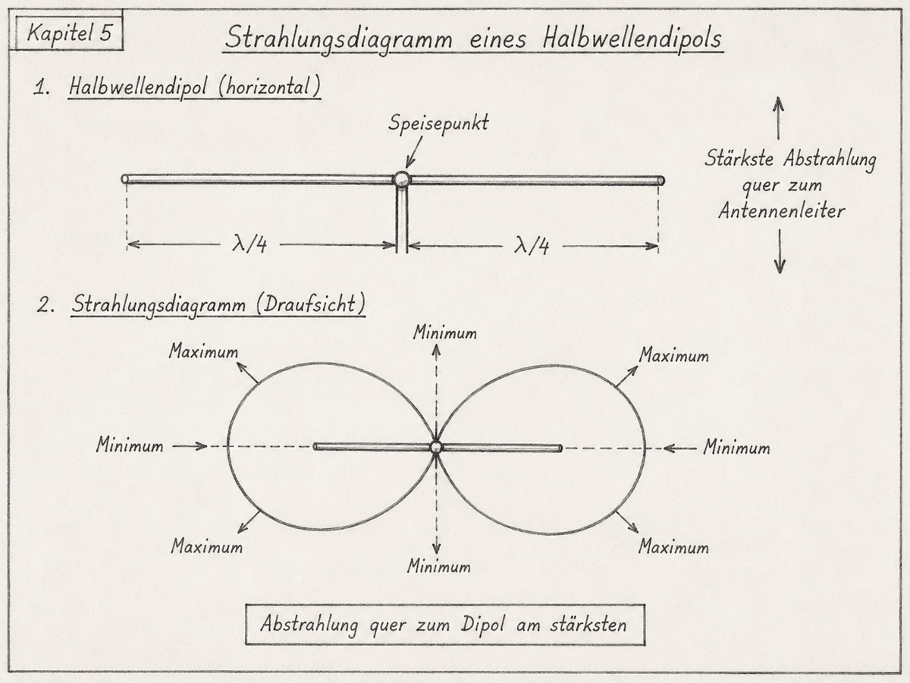

**Abbildung 5-1:** Vereinfachtes Strahlungsdiagramm eines horizontalen Halbwellendipols. Die stärkste Abstrahlung erfolgt quer zur Dipolachse.
.
.

## Warum entsteht dieses Diagramm?

Die Hochfrequenzströme verteilen sich entlang des Dipols.

Die von den einzelnen Leiterabschnitten abgestrahlten Felder überlagern sich im Raum.

In bestimmten Richtungen addieren sie sich besonders stark.

In Verlängerung des Dipols löschen sich die Beiträge weitgehend gegenseitig aus.

---

# Die typische Acht

Im horizontalen Schnitt eines horizontalen Dipols entsteht idealisiert eine Form, die häufig als:

**Acht**

bezeichnet wird.

Dabei befinden sich die beiden Hauptstrahlrichtungen:

**senkrecht zum Draht**

Die beiden Minima befinden sich:

**in Richtung der Drahtenden**

## Praktische Bedeutung

Wer mit einem horizontalen Dipol bevorzugt nach Osten und Westen funken möchte, spannt ihn ungefähr:

**Nord-Süd**

Die Drahtachse und Hauptstrahlrichtung stehen also ungefähr senkrecht aufeinander.

---

# Dreidimensionales Strahlungsfeld

Die bekannte Acht ist nur ein zweidimensionaler Schnitt.

Das vollständige Strahlungsfeld eines idealisierten Dipols erinnert an einen:

**Ring beziehungsweise Torus**

um die Antennenachse.

Man sollte deshalb nicht denken, die Antenne strahle tatsächlich nur entlang zweier dünner Linien.

---

# Groundplane

Die Groundplane besteht grundsätzlich aus:

- vertikalem Strahler
- Radialen beziehungsweise Gegensystem

Der Strahler besitzt typischerweise eine Länge in der Grössenordnung:

\[
\frac{\lambda}{4}
\]

Bei einer vertikalen Groundplane ist die Polarisation grundsätzlich:

**vertikal**
.
.

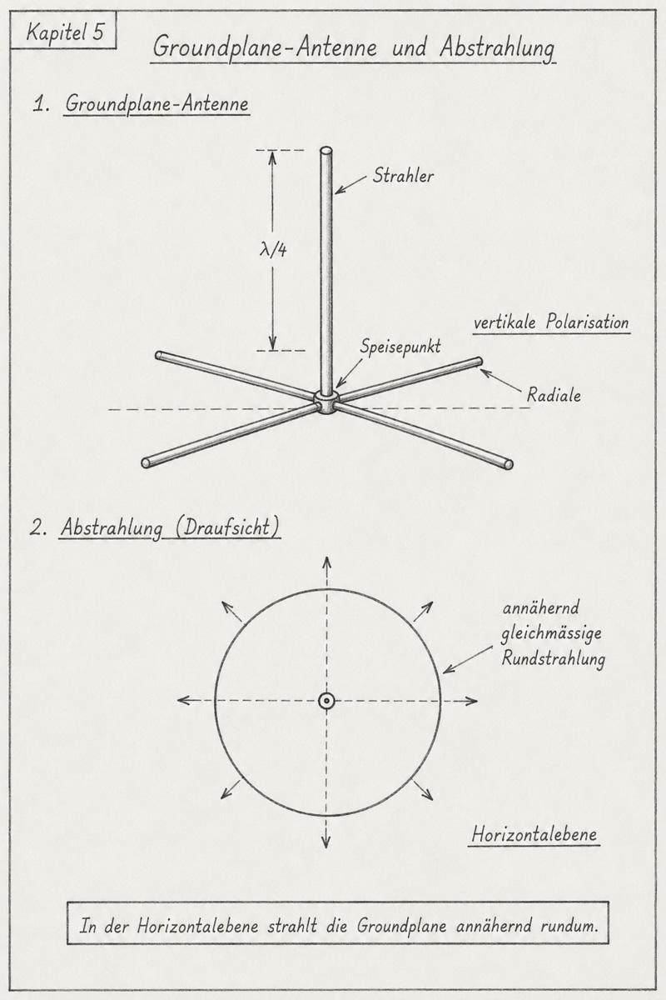

**Abbildung 5-2:** Vertikale Groundplane und vereinfachte horizontale Rundstrahlcharakteristik. In der Horizontalebene wird annähernd in alle Richtungen abgestrahlt.
.
.

---

# Rundstrahlcharakteristik

Eine ideale vertikale Groundplane besitzt in der Horizontalebene eine annähernd kreisförmige Charakteristik.

Sie wird deshalb häufig als:

**Rundstrahler**

bezeichnet.

Das bedeutet nicht, dass sie in allen Raumrichtungen gleich stark abstrahlt.

Nach oben entlang der Antennenachse befindet sich kein gleich starkes Strahlungsmaximum.

## Nicht verwechseln

**Rundstrahler**

bedeutet normalerweise:

annähernd gleichmässige Abstrahlung in der Horizontalebene.

Es bedeutet nicht:

gleichmässige Abstrahlung in jede Richtung des dreidimensionalen Raumes.

---

# Der isotrope Strahler

Für Antennenvergleiche benötigt man eine eindeutig definierte Referenz.

Dazu verwendet man den theoretischen:

**isotropen Strahler**

Er strahlt die zugeführte Energie idealisiert:

**in alle Raumrichtungen gleichmässig**

ab.

Sein Strahlungsdiagramm wäre eine Kugel.
.
.

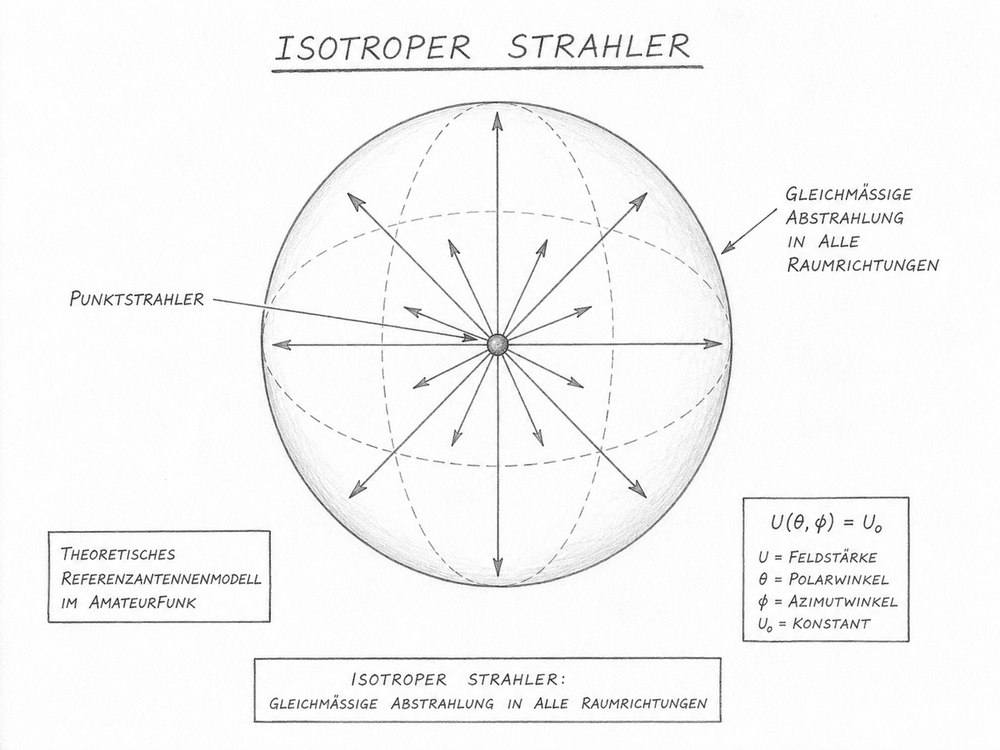

**Abbildung 5-5:** Der isotrope Strahler ist eine theoretische Referenzantenne mit gleicher Abstrahlung in alle Raumrichtungen.
.
.

## Wichtig

Einen idealen isotropen Strahler kann man praktisch nicht bauen.

Er ist ein:

**mathematisches Vergleichsmodell**

und wird insbesondere für die Angabe:

**dBi**

verwendet.

---

# Antennengewinn

Eine Richtantenne konzentriert einen grösseren Anteil der vorhandenen Leistung in bestimmte Richtungen.

Dadurch entsteht dort gegenüber einer Referenzantenne ein höherer Feldpegel.

Dies wird als:

**Antennengewinn**

bezeichnet.

Wichtig:

> **Eine passive Antenne erzeugt keine zusätzliche Leistung.**

Der Gewinn entsteht durch räumliche Umverteilung.

Wo mehr abgestrahlt wird, muss in anderen Richtungen entsprechend weniger abgestrahlt werden.

---

# Gewinnfaktor und Dezibel

Der lineare Gewinnfaktor kann mit:

\[
G
\]

bezeichnet werden.

Die logarithmische Angabe lautet:

\[
g = 10\cdot\lg(G)
\]

Umgekehrt:

\[
G = 10^{g/10}
\]

Ein Gewinn von:

\[
3\ \mathrm{dB}
\]

entspricht ungefähr einem Leistungsfaktor von:

\[
2
\]

Ein Gewinn von:

\[
10\ \mathrm{dB}
\]

entspricht einem Faktor von:

\[
10
\]

in der betreffenden Richtung gegenüber der verwendeten Referenz.

---

# dBi und dBd

Ein Gewinnwert ist nur sinnvoll, wenn bekannt ist, auf welche Referenzantenne er sich bezieht.

## dBi

Bezug auf den:

**isotropen Strahler**

## dBd

Bezug auf den:

**Halbwellendipol**

Ein idealisierter Halbwellendipol besitzt gegenüber dem Isotropstrahler:

\[
2{,}15\ \mathrm{dBi}
\]

Damit gilt:

\[
g_i = g_d = + = 2{,}15\ \mathrm{dB}
\]

beziehungsweise:

\[
g_d = # g_i = 2{,}15\ \mathrm{dB}
\]

---

# Beispiel dBi und dBd

Eine Antenne besitzt:

\[
6\ \mathrm{dBd}
\]

Dann beträgt ihr Gewinn bezogen auf den Isotropstrahler:

\[
g_i = 6 = + = 2{,}15
\]

\[
g_i = 8{,}15\ \mathrm{dBi}
\]

Die Antenne ist dadurch nicht plötzlich besser geworden.

Nur die:

**Bezugsantenne**

wurde geändert.

---

# Richtantenne

Eine Richtantenne strahlt bevorzugt in eine oder mehrere bestimmte Richtungen.

Typische Richtantennen sind:

- Yagi
- HB9CV
- Quad
- Parabolantenne
- Hornantenne
- Helix in axialer Betriebsweise

Die Richtwirkung ist besonders nützlich für:

- DX
- Punkt-zu-Punkt-Verbindungen
- Satellitenfunk
- Richtfunk
- schwache Signale

---

# Yagi-Uda-Antenne

Die Yagi ist eine der bekanntesten Richtantennen.

Sie besteht typischerweise aus:

- gespeistem Element
- Reflektor
- einem oder mehreren Direktoren

Das gespeiste Element ist häufig ein:

**Dipol**

oder:

**Faltdipol**
.
.

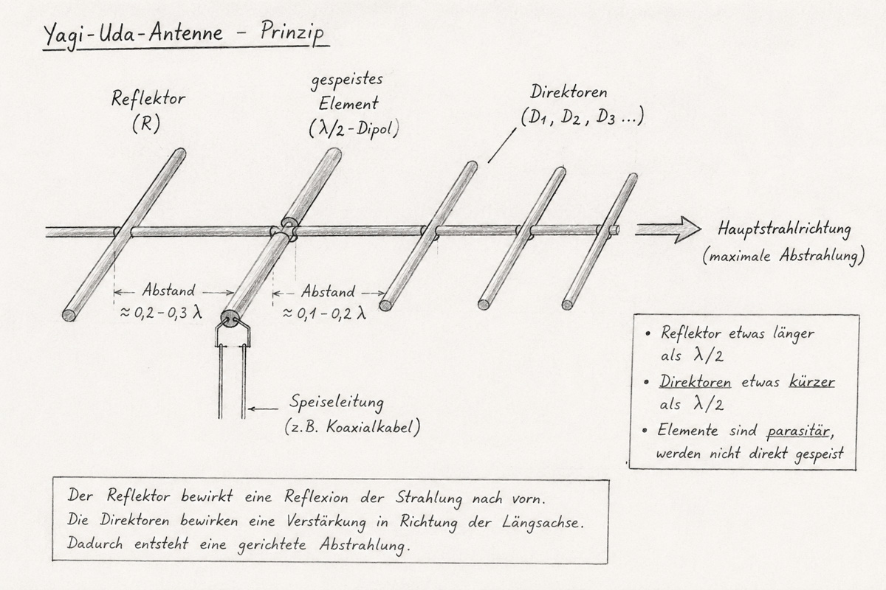

**Abbildung 5-3:** Grundprinzip einer Yagi-Antenne mit Reflektor, gespeistem Element und Direktoren. Die Hauptstrahlrichtung zeigt zur Direktorenseite.
.
.

---

# Reflektor

Der Reflektor befindet sich hinter dem gespeisten Element.

Er ist typischerweise etwas länger als das resonante gespeiste Element.

Er beeinflusst das elektromagnetische Feld so, dass die Abstrahlung in Rückwärtsrichtung vermindert und die Abstrahlung nach vorne verstärkt wird.

---

# Direktoren

Die Direktoren befinden sich vor dem gespeisten Element.

Sie sind typischerweise etwas kürzer.

Mehrere Direktoren können:

- Richtwirkung erhöhen
- Hauptkeule schmaler machen
- Gewinn vergrössern

Dies geschieht jedoch nicht unbegrenzt.

Die genaue Dimensionierung ist Teil des Antennenentwurfs.

---

# Parasitäre Elemente

Reflektor und Direktoren einer klassischen Yagi werden nicht direkt über ein Kabel gespeist.

Sie werden durch das elektromagnetische Feld des gespeisten Elements angeregt.

Solche Elemente nennt man:

**parasitäre Elemente**

Das Wort «parasitär» bedeutet hier nicht, dass sie nutzlos sind.

Im Gegenteil, sie erzeugen gezielt die gewünschte Richtwirkung.

---

# Hauptstrahlrichtung

Bei einer klassischen Yagi liegt die Hauptstrahlrichtung:

**vom Reflektor über das gespeiste Element zu den Direktoren**

Vereinfacht:

**Reflektor → Dipol → Direktoren → Hauptstrahlrichtung**

---

# Strahlungsdiagramm einer Richtantenne

Eine reale Richtantenne strahlt nicht ausschliesslich in einer einzigen Richtung.

Das Diagramm besitzt typischerweise:

- Hauptkeule
- Nebenkeulen
- Rückkeule
  .
  .

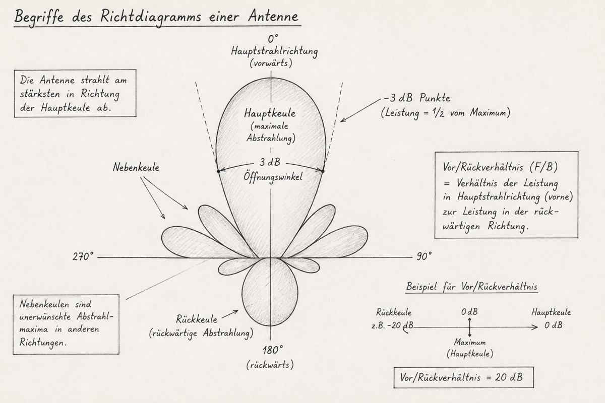

**Abbildung 5-4:** Vereinfachtes Richtdiagramm mit Hauptkeule, Nebenkeulen, Rückkeule und 3-dB-Öffnungswinkel.
.
.

---

# Hauptkeule

Die:

**Hauptkeule**

bezeichnet den Bereich mit der stärksten gewünschten Abstrahlung.

Ihre Richtung wird als:

**Hauptstrahlrichtung**

bezeichnet.

---

# Nebenkeulen

Weitere kleinere Abstrahlungsmaxima werden als:

**Nebenkeulen**

bezeichnet.

Sie sind in vielen Anwendungen unerwünscht, lassen sich aber bei realen Antennen nicht immer vollständig vermeiden.

---

# Rückkeule

Die Abstrahlung ungefähr entgegen der Hauptstrahlrichtung wird als:

**Rückkeule**

bezeichnet.

Eine gute Richtantenne soll je nach Anwendung möglichst wenig Energie nach hinten abstrahlen.

---

# Vor-Rück-Verhältnis

Das Verhältnis zwischen der Abstrahlung:

**nach vorne**

und:

**nach hinten**

wird als:

**Vor-Rück-Verhältnis**

bezeichnet.

Es wird normalerweise in:

**dB**

angegeben.

Ein grosses Vor-Rück-Verhältnis bedeutet:

Die Antenne strahlt in Hauptstrahlrichtung deutlich stärker als in die entgegengesetzte Richtung.

---

# Beispiel Vor-Rück-Verhältnis

Ein Vor-Rück-Verhältnis von:

\[
20\ \mathrm{dB}
\]

bedeutet bezüglich Leistung ein Verhältnis von ungefähr:

\[
100:1
\]

Die Leistung in Hauptstrahlrichtung ist damit im Vergleich zur exakt entgegengesetzten Richtung etwa hundertmal grösser.

Dies ist ein Verhältnis und keine Aussage über die gesamte abgestrahlte Leistung.

---

# Öffnungswinkel

Die Hauptkeule besitzt eine bestimmte Breite.

Als:

**3-dB-Öffnungswinkel**

bezeichnet man den Winkel zwischen den beiden Richtungen, in denen die Leistung gegenüber dem Maximum um:

\[
3\ \mathrm{dB}
\]

abgefallen ist.

Da:

\[
-3\ \mathrm{dB}
\]

ungefähr halber Leistung entspricht, spricht man auch von den:

**Halbwertspunkten**

---

# Schmale und breite Hauptkeule

Eine schmale Hauptkeule bedeutet:

- stärkere Richtwirkung
- präzisere Ausrichtung notwendig

Eine breite Hauptkeule bedeutet:

- grössere Winkelabdeckung
- geringere Richtwirkung

Für verschiedene Anwendungen kann beides sinnvoll sein.

---

# Horizontaler Dipol

Ein horizontal montierter Halbwellendipol erzeugt grundsätzlich:

**horizontale Polarisation**
.
.

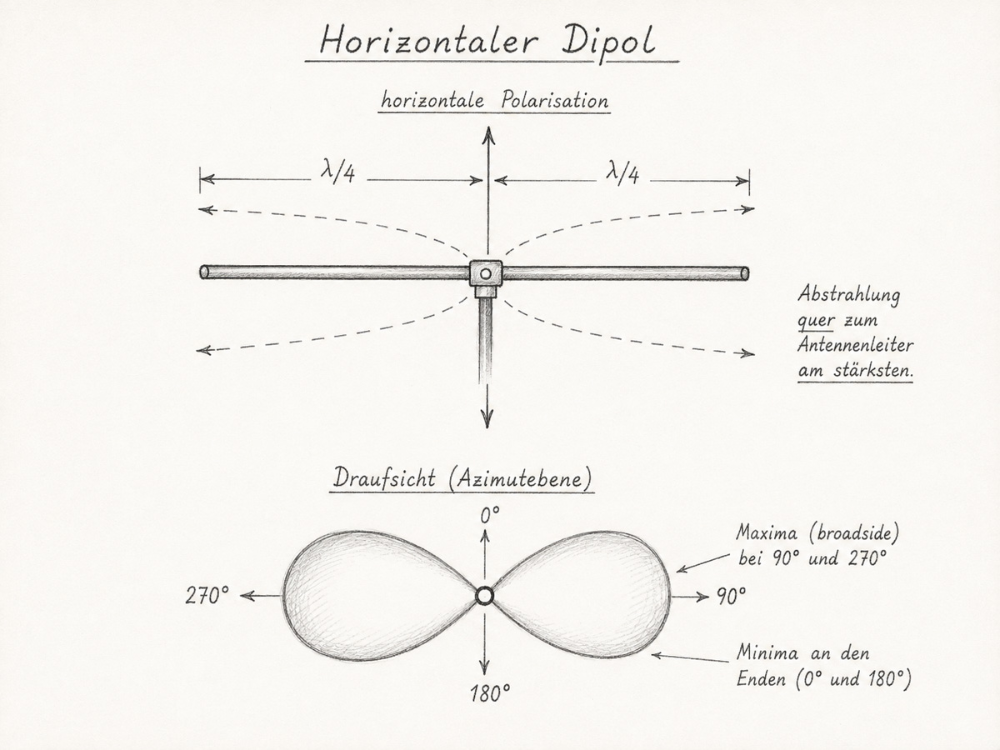

**Abbildung 5-6:** Horizontal montierter Halbwellendipol. Das elektrische Feld und damit die Polarisation liegen grundsätzlich horizontal.
.
.
Diese Polarisation wird auf Kurzwelle häufig verwendet.
.
.

---

# Vertikaler Dipol

Wird derselbe Dipol vertikal montiert, besitzt er grundsätzlich:

**vertikale Polarisation**

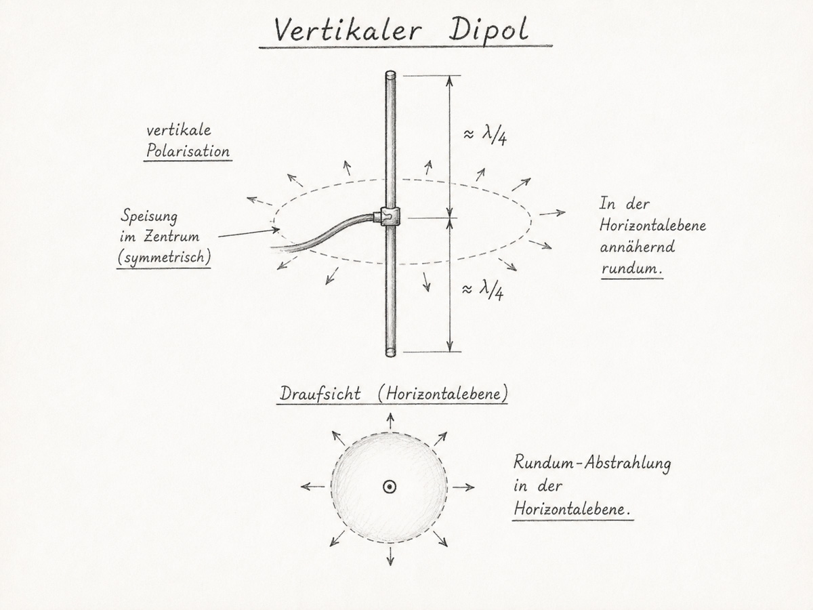

**Abbildung 5-7:** Vertikal montierter Dipol mit vertikaler Polarisation.

Vertikale Polarisation ist beispielsweise bei:

- mobilen VHF/UHF-Verbindungen
- Handfunkgeräten
- vielen Relaisverbindungen

sehr gebräuchlich.

---

# Faltdipol

Ein:

**Faltdipol**

besteht vereinfacht aus zwei parallelen Leitern, die an den Enden miteinander verbunden sind.

Die Gesamtausdehnung entspricht ungefähr jener eines Halbwellendipols.
.
.

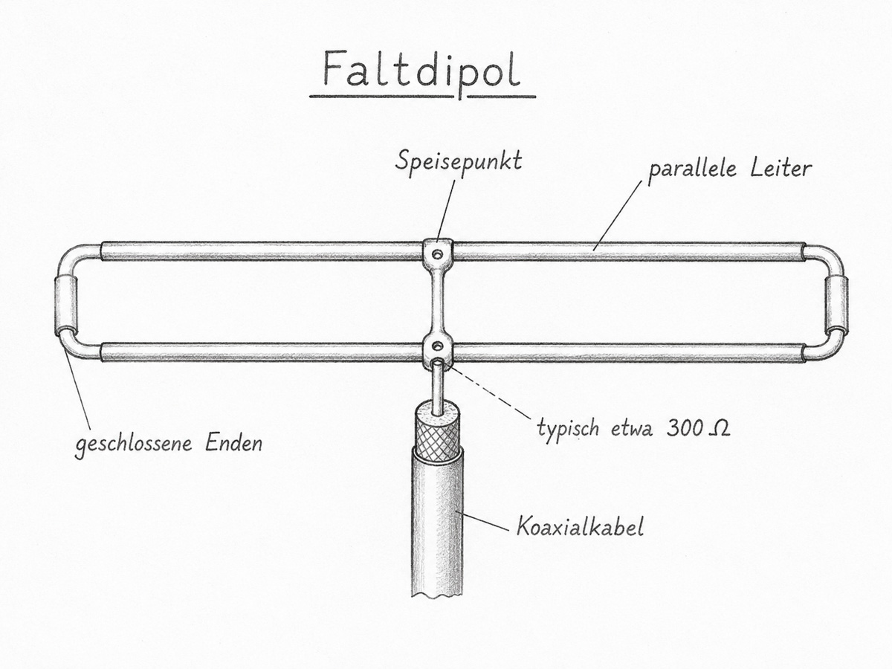

**Abbildung 5-8:** Grundform eines Faltdipols. Gegenüber dem einfachen gestreckten Dipol besitzt er bei typischer symmetrischer Ausführung einen höheren Speisepunktwiderstand.
.
.

---

# Speisepunktwiderstand des Faltdipols

Ein symmetrischer Faltdipol mit zwei gleichartigen parallelen Leitern besitzt idealisiert einen Speisepunktwiderstand von ungefähr:

\[
300\ \Omega
\]

Der einfache Halbwellendipol liegt dagegen in der Grössenordnung von:

\[
73\ \Omega
\]

beziehungsweise praktisch oft mit:

\[
75\ \Omega
\]

angegeben.

Der exakte Wert hängt wiederum von der realen Konstruktion und Umgebung ab.

---

# Warum Faltdipol?

Faltdipole werden unter anderem verwendet wegen:

- höherem Speisepunktwiderstand
- günstigen mechanischen Eigenschaften
- teilweise grösserer Bandbreite
- guter Eignung als gespeistes Element in Richtantennen

Bei vielen klassischen VHF- und UHF-Yagis findet man deshalb Faltdipole.

---

# HB9CV-Antenne

Die:

**HB9CV**

ist eine kompakte Richtantenne mit zwei aktiv gekoppelten Elementen.

Sie wurde vom Schweizer Funkamateur Rudolf Baumgartner, HB9CV, entwickelt.

Die beiden Elemente werden mit einer definierten:

- Amplitudenbeziehung
- Phasenbeziehung

gespeist.

Dadurch entsteht eine ausgeprägte Richtwirkung.
.
.

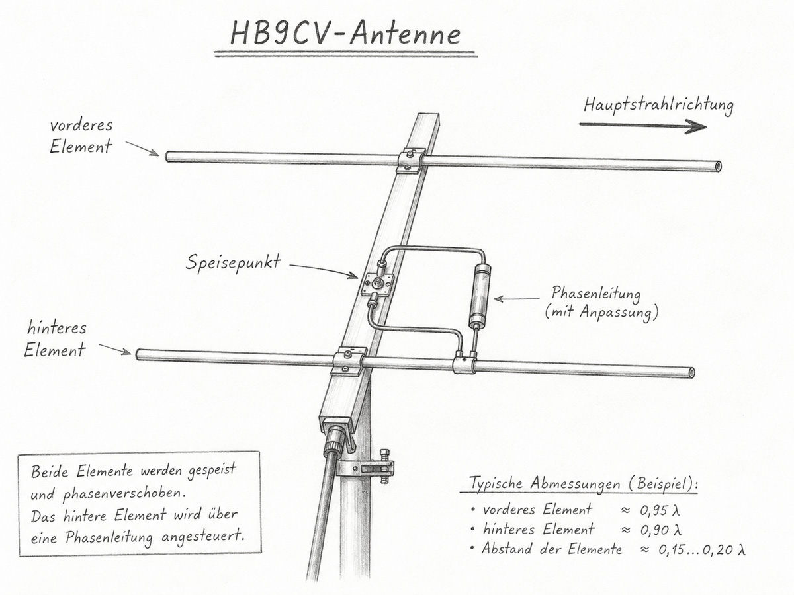

**Abbildung 5-9:** Grundprinzip der HB9CV-Antenne. Zwei aktiv gekoppelte Elemente erzeugen durch geeignete Phasenlage eine Richtwirkung.
.
.

---

# Unterschied HB9CV und Yagi

Bei der klassischen Yagi ist typischerweise nur ein Element direkt gespeist.

Reflektor und Direktoren sind parasitär.

Bei der HB9CV werden dagegen:

**beide Hauptelemente aktiv gespeist beziehungsweise gekoppelt**

Die Richtwirkung entsteht deshalb nach einem anderen Prinzip.

---

# Quad-Antenne

Eine Quad verwendet ein oder mehrere geschlossene Draht- oder Rohrelemente.

Ein einzelnes resonantes Quad-Element besitzt typischerweise einen Umfang in der Grössenordnung von:

\[
\lambda
\]

Mehrere hintereinander angeordnete Schleifen können eine Richtantenne bilden.
.
.

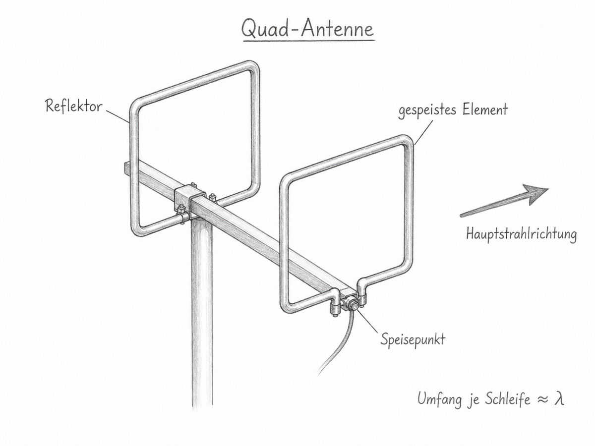

**Abbildung 5-10:** Vereinfachte Quad-Richtantenne. Die Schleifenelemente liegen hintereinander entlang der Antennenachse.
.
.

---

# Warum heisst sie Quad?

Die klassische Bauform verwendet quadratische Schleifen.

Elektrisch entscheidend ist jedoch nicht, dass die Schleife geometrisch exakt quadratisch sein muss.

Es existieren beispielsweise auch:

- rautenförmige
- rechteckige
- andere geschlossene Schleifenformen

---

# Eigenschaften einer Quad

Je nach Ausführung kann eine Quad:

- Richtwirkung
- Gewinn
- gutes Vor-Rück-Verhältnis

besitzen.

Sie wird vor allem auf:

- Kurzwelle
- VHF
- UHF

eingesetzt.

Die genaue Speisepunktimpedanz hängt von Geometrie und Aufbau ab.

---

# Magnetic Loop

Eine:

**Magnetic Loop**

ist eine elektrisch kleine Schleifenantenne, deren Umfang häufig deutlich kleiner als eine Wellenlänge ist.

Sie besteht typischerweise aus:

- grosser leitender Hauptschleife
- Abstimmkondensator
- kleinerer Koppelschleife oder anderer Kopplung
  .
  .

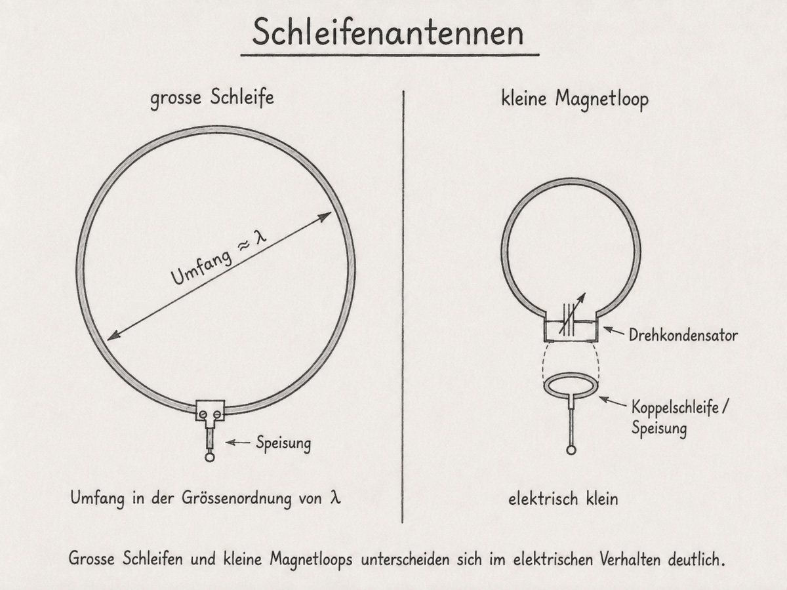

**Abbildung 5-11:** Prinzip einer Magnetic Loop. Die grosse Hauptschleife bildet gemeinsam mit dem variablen Kondensator einen abgestimmten Schwingkreis. Die kleine Schleife dient der HF-Kopplung.
.
.

---

# Resonanz der Magnetic Loop

Die grosse Schleife besitzt eine Induktivität.

Gemeinsam mit dem Abstimmkondensator entsteht ein:

**LC-Schwingkreis**

Seine Resonanzfrequenz wird durch:

- Schleifeninduktivität
- Kapazität

bestimmt.

Dadurch kann eine mechanisch relativ kleine Antenne auf einer deutlich grösseren Wellenlänge resonant betrieben werden.

---

# Hohe Ströme und Spannungen

In einer resonanten Magnetic Loop können sehr hohe HF-Ströme fliessen.

Am Abstimmkondensator können gleichzeitig sehr hohe HF-Spannungen auftreten.

Deshalb sind:

- niedrige Übergangswiderstände
- stabile Leiter
- geeignete Kondensatoren

besonders wichtig.

Eine kleine Loop bedeutet also nicht automatisch geringe elektrische Belastungen.

---

# Bandbreite der Magnetic Loop

Eine effiziente kleine Magnetic Loop besitzt typischerweise eine relativ hohe Güte.

Daraus folgt eine:

**kleine Bandbreite**

Schon eine kleine Frequenzänderung kann deshalb eine erneute Abstimmung erfordern.

Dies ist eine typische Folge elektrisch kleiner resonanter Antennen.

---

# Richtwirkung der Magnetic Loop

Eine kleine Loop besitzt typischerweise ausgeprägte:

**Nullstellen**

in bestimmten Richtungen.

Diese können beim Empfang sehr nützlich sein, um:

- lokale Störungen
- unerwünschte Signale

durch Drehen der Antenne zu vermindern.

Die Richtung maximaler Empfindlichkeit und die Nullrichtungen hängen von der Orientierung der Schleife ab.

---

# Parabolantenne

Eine Parabolantenne verwendet einen:

**parabolisch geformten Reflektor**

Elektromagnetische Wellen werden zwischen:

- Brennpunkt
- parallelem Strahlenbündel

umgesetzt.
.
.

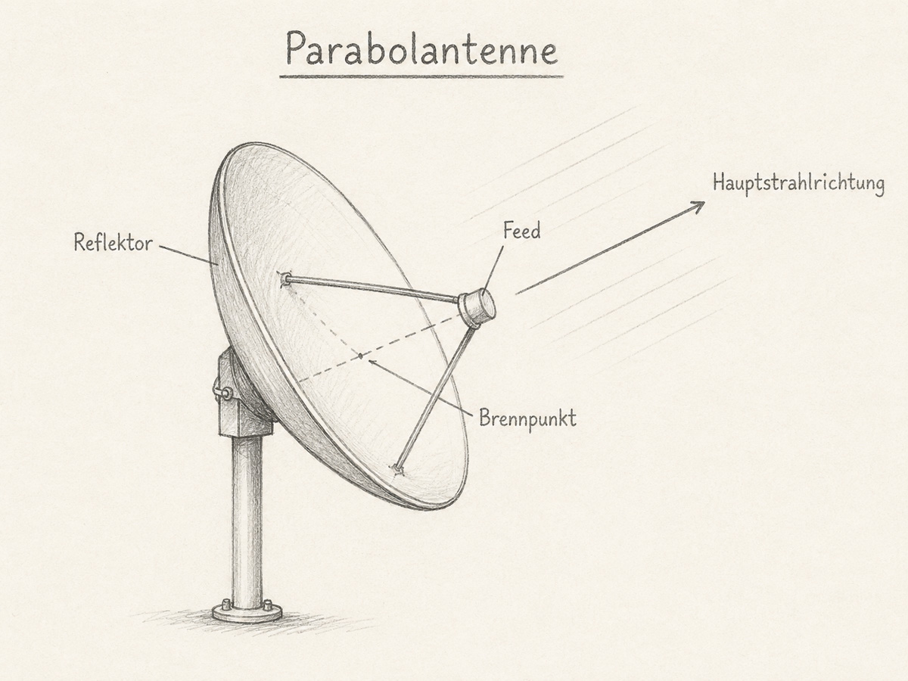

**Abbildung 5-12:** Prinzip einer Parabolantenne. Der Reflektor bündelt die elektromagnetische Energie zwischen Brennpunkt und Hauptstrahlrichtung.
.
.

---

# Parabolantenne beim Senden

Ein Speisesystem befindet sich ungefähr im Brennpunkt.

Die vom Speisesystem abgestrahlten Wellen treffen auf den Reflektor.

Dieser formt daraus ein stark gerichtetes Strahlungsfeld.

---

# Parabolantenne beim Empfang

Der Vorgang läuft umgekehrt.

Nahezu parallel eintreffende Wellen werden vom Reflektor zum:

**Brennpunkt**

geführt.

Dort befindet sich die Empfangsantenne beziehungsweise das Speisesystem.

---

# Grösse und Richtwirkung

Entscheidend ist nicht nur der absolute Durchmesser des Spiegels, sondern besonders das Verhältnis:

\[
\frac{D}{\lambda}
\]

Ein Parabolspiegel mit 1 m Durchmesser ist bei einer Wellenlänge von wenigen Zentimetern elektrisch sehr gross.

Auf 80 m Wellenlänge wäre derselbe Spiegel dagegen praktisch winzig.

Deshalb werden Parabolantennen vor allem bei:

- UHF
- SHF
- Mikrowellen

verwendet.

---

# Hornantenne

Eine:

**Hornantenne**

ist eine aufgeweitete Wellenleiterstruktur.

Sie ermöglicht einen günstigen Übergang zwischen:

- Hohlleiter
- freiem Raum
  .
  .

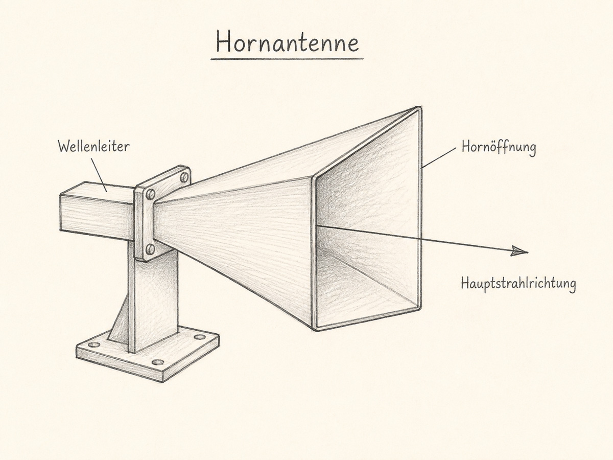

**Abbildung 5-13:** Vereinfachte Hornantenne als Übergang zwischen Wellenleiter und freiem Raum.
.
.

---

# Anwendung der Hornantenne

Hornantennen werden insbesondere im:

- Mikrowellenbereich
- Messwesen
- Richtfunk
- Radar

verwendet.

Sie können auch als:

**Speiseantenne eines Parabolspiegels**

dienen.

---

# Helixantenne

Eine:

**Helixantenne**

besteht aus einem schraubenförmig gewickelten Leiter.

Je nach Dimensionierung kann sie in verschiedenen Betriebsweisen arbeiten.

Für Richtfunk und Satellitenbetrieb ist besonders die:

**axiale Betriebsweise**

interessant.
.
.

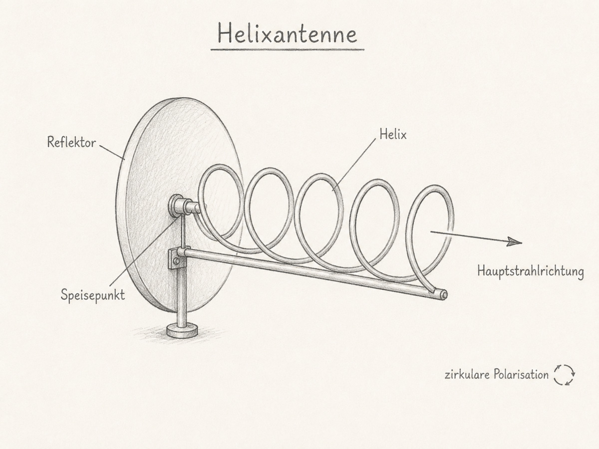

**Abbildung 5-14:** Helixantenne in axialer Betriebsweise. Die Hauptstrahlrichtung verläuft entlang der Längsachse der Helix.
.
.

---

# Polarisation der Helix

Eine axial betriebene Helix kann:

**zirkulare Polarisation**

erzeugen beziehungsweise empfangen.

Dadurch eignet sie sich unter anderem für:

- Satellitenfunk
- Raumfahrtkommunikation
- bestimmte Richtfunkanwendungen

Wichtig ist dabei auch der:

**Drehsinn**

der zirkularen Polarisation.

---

# Polarisation nochmals im Vergleich

Die wichtigsten Grundformen sind:

- horizontal linear
- vertikal linear
- zirkular
- elliptisch
  .
  .

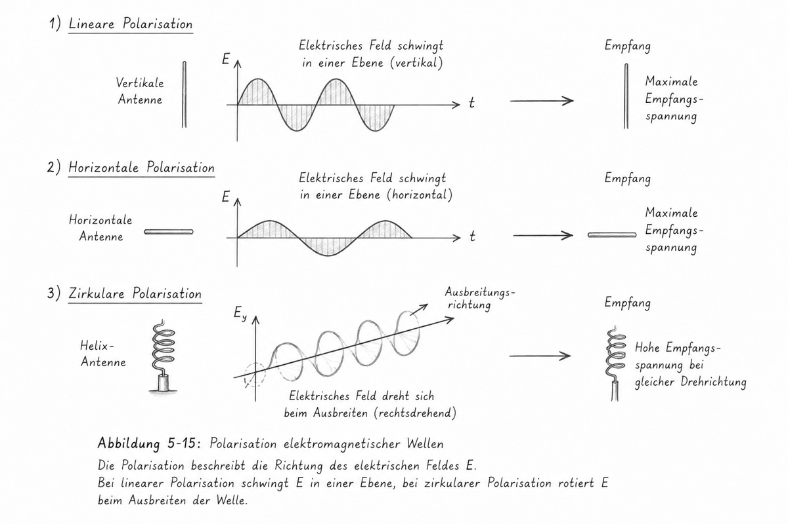

**Abbildung 5-15:** Vereinfachter Vergleich verschiedener Polarisationen. Bei linearer Polarisation bleibt die Richtung des elektrischen Feldes konstant. Bei zirkularer beziehungsweise elliptischer Polarisation dreht sich der Feldvektor.
.
.

---

# Polarisationsanpassung

Sende- und Empfangsantenne koppeln besonders gut, wenn ihre Polarisation zueinander passt.

Beispiel:

**vertikal → vertikal**

oder:

**horizontal → horizontal**

Bei zwei idealen linearen Antennen, die exakt um:

\[
90^\circ
\]

gegeneinander verdreht sind, entsteht theoretisch eine sehr starke Polarisationsdämpfung.

In der Praxis können Reflexionen und Streuung diese ideale Trennung jedoch vermindern.

---

# Warum VHF-FM meist vertikal?

Im mobilen und portablen VHF/UHF-Betrieb werden häufig vertikale Antennen eingesetzt.

Gründe sind unter anderem:

- Fahrzeugantennen lassen sich einfach vertikal montieren
- Handfunkgeräte besitzen typischerweise vertikale Antennen
- Rundstrahlcharakteristik ist für mobile Kommunikation günstig

Deshalb ist vertikale Polarisation bei vielen:

- FM-Simplexverbindungen
- Relaisverbindungen

üblich.

---

# Warum SSB und schwache Signale häufig horizontal?

Bei stationären VHF/UHF-Verbindungen mit:

- SSB
- CW
- schwachen Signalen
- DX

wird häufig horizontale Polarisation verwendet.

Dazu passen Richtantennen wie horizontal montierte Yagis.

Die verwendete Polarisation ist jedoch eine Betriebsvereinbarung und keine physikalische Pflicht der Modulationsart.

---

# Gestockte Antennen

Mehrere Antennen können räumlich so angeordnet und gespeist werden, dass ihre Felder gezielt zusammenwirken.

Dies nennt man:

**Stockung**

beziehungsweise:

**Antennengruppe**

Dadurch kann die Strahlungscharakteristik gezielt verändert werden.

Beispiele:

- zwei übereinander angeordnete Yagis
- vier Yagis in einem Array
- vertikal gestockte Rundstrahler

---

# Warum Stockung?

Durch geeignete Phasenlage und Abstände können:

- Gewinn
- Öffnungswinkel
- vertikales Strahlungsdiagramm

beeinflusst werden.

Die Gesamtleistung wird dabei wiederum nicht von der Antenne erzeugt.

Sie wird räumlich anders verteilt.

---

# HB9-Vertiefung: Phasenlage

Für Richtantennen ist nicht nur entscheidend:

**wie viel Strom**

in einem Element fliesst.

Ebenso wichtig ist:

**mit welcher Phase**

dieser Strom fliesst.

Zwei räumlich getrennte Elemente können ihre Felder in einer Richtung:

**addieren**

und in einer anderen Richtung:

**teilweise oder vollständig auslöschen**

Genau dieses Prinzip bildet die Grundlage vieler:

- Richtantennen
- Antennengruppen
- Phased Arrays

---

# Phased Array

Bei einem:

**Phased Array**

werden mehrere Antennenelemente mit kontrollierten:

- Amplituden
- Phasenlagen

gespeist.

Dadurch kann die Hauptstrahlrichtung beeinflusst werden.

In komplexen Systemen kann dies sogar ohne mechanisches Drehen der Antenne erfolgen.

Das Grundprinzip ist wichtig.

Die mathematische Auslegung komplexer Arrays gehört jedoch nicht zum grundlegenden HB3/HB9-Lernziel dieses Kapitels.

---

# Welche Antenne für welche Aufgabe?

Es gibt keine universell beste Antenne.

## Lokaler Mobilfunk

Oft sinnvoll:

- vertikale Antenne
- Rundstrahlcharakteristik

## Kurzwellen-DX

Je nach Möglichkeiten:

- horizontaler Dipol
- Beam
- Yagi
- Quad

## VHF/UHF-DX

Häufig:

- Yagi
- gestockte Yagis
- andere stark gerichtete Systeme

## Satelliten

Je nach System:

- Yagi
- gekreuzte Yagi
- Helix
- zirkular polarisierte Antenne

## Mikrowellen

Häufig:

- Parabolantenne
- Horn
- entsprechende Feed-Systeme

---

# Antennengewinn und Wirkungsgrad nicht verwechseln

Eine Richtantenne kann hohen Gewinn besitzen, weil sie Energie räumlich konzentriert.

Der Wirkungsgrad beschreibt dagegen, welcher Anteil der zugeführten Leistung tatsächlich abgestrahlt wird.

Beispiel:

Eine Antenne könnte einen guten Richtfaktor besitzen, aber gleichzeitig hohe ohmsche Verluste haben.

Dann ist ihre tatsächliche Leistung schlechter, als der reine Richtfaktor vermuten lässt.

---

# Richtwirkung und Gewinn

Auch diese Begriffe werden häufig gleichgesetzt, sind streng betrachtet aber nicht identisch.

## Richtwirkung

beschreibt die räumliche Konzentration gegenüber einer idealisierten gleichmässigen Abstrahlung, ohne Verluste einzubeziehen.

## Gewinn

berücksichtigt zusätzlich den Wirkungsgrad der realen Antenne.

Für das grundlegende Amateurfunkverständnis werden beide Begriffe in der Praxis häufig gemeinsam betrachtet.

Für HB9 ist die Unterscheidung technisch sinnvoll.

---

# Anpassung und Gewinn sind unabhängig

Eine Antenne kann:

- hohen Gewinn
- schlechte Anpassung

besitzen.

Oder:

- perfektes SWR
- praktisch keinen Richtgewinn

zeigen.

Deshalb müssen folgende Eigenschaften getrennt beurteilt werden:

- Anpassung
- Wirkungsgrad
- Richtwirkung
- Gewinn
- Bandbreite

---

# Bandbreite einer Richtantenne

Auch Richtantennen besitzen einen begrenzten nutzbaren Frequenzbereich.

Mit zunehmender Abweichung von der Entwurfsfrequenz können sich verändern:

- SWR
- Gewinn
- Vor-Rück-Verhältnis
- Strahlungsdiagramm

Eine Yagi kann deshalb auf ihrer Entwurfsfrequenz ausgezeichnet funktionieren und an einem deutlich anderen Bandende bereits schlechtere Eigenschaften besitzen.

---

# Antennenrichtung beim Empfang

Eine Richtantenne verbessert nicht nur das Sendesignal in eine gewünschte Richtung.

Beim Empfang kann sie gleichzeitig:

- das Nutzsignal aus dieser Richtung bevorzugen
- Störer aus anderen Richtungen unterdrücken

In stark gestörter Umgebung kann diese Richtwirkung wichtiger sein als zusätzlicher Sendegwinn.

---

# Nullstellen können besonders wertvoll sein

Bei Empfangsproblemen ist nicht immer die Richtung mit dem grössten Gewinn entscheidend.

Eine tiefe:

**Nullstelle**

in Richtung eines Störers kann einen grossen praktischen Vorteil bringen.

Dies ist besonders bei:

- Magnetic Loops
- Richtantennen
- Antennengruppen

nützlich.

---

# Reziprozität

Eine passive lineare Antenne besitzt grundsätzlich dieselbe Richtcharakteristik beim:

**Senden**

und:

**Empfangen**

Eine Richtung mit hohem Sendegwinn besitzt deshalb grundsätzlich auch eine entsprechend hohe Empfangsempfindlichkeit.

Dies wird als:

**Reziprozität**

bezeichnet.

---

# Drei Dinge, die man nicht verwechseln darf

## Rundstrahler und Isotropstrahler

| Begriff | Bedeutung |
| --- | --- |
| Rundstrahler | annähernd gleichmässige Abstrahlung in einer Ebene |
| Isotropstrahler | theoretisch gleiche Abstrahlung in alle Raumrichtungen |

## dBi und dBd

| Angabe | Referenz |
| --- | --- |
| dBi | Isotropstrahler |
| dBd | Halbwellendipol |

## Richtwirkung und Leistung

Antennengewinn bedeutet:

**Energie räumlich konzentrieren**

nicht:

**zusätzliche Energie erzeugen**

## Öffnungswinkel und Vor-Rück-Verhältnis

**Öffnungswinkel**

→ Breite der Hauptkeule

**Vor-Rück-Verhältnis**

→ Verhältnis Hauptstrahlrichtung zu exakt entgegengesetzter Richtung

---

# Antennenübersicht

| Antenne | typische Charakteristik | typische Polarisation | typische Anwendung |
| --- | --- | --- | --- |
| horizontaler Dipol | bidirektional | horizontal | Kurzwelle |
| vertikaler Dipol | Rundstrahler horizontal | vertikal | VHF/UHF |
| Groundplane | Rundstrahler horizontal | vertikal | mobil, VHF/UHF |
| Faltdipol | ähnlich Dipol | abhängig von Montage | Yagi-Speiseelement |
| Yagi | stark gerichtet | abhängig von Montage | DX, VHF/UHF |
| HB9CV | gerichtet | abhängig von Montage | portable/VHF/UHF |
| Quad | gerichtet | abhängig von Speisepunkt | KW bis UHF |
| Magnetic Loop | bidirektional mit Nullstellen | abhängig von Montage | KW, Empfang, kompakte Systeme |
| Parabol | stark gerichtet | abhängig vom Feed | Mikrowellen |
| Horn | gerichtet | abhängig von Aufbau | Mikrowellen |
| Helix axial | gerichtet | zirkular | Satelliten, Mikrowellen |

Die Tabelle beschreibt typische Ausführungen. Viele Antennenformen können unterschiedlich aufgebaut und polarisiert werden.

---

# Lernschema

Bei einer Frage zu einer Antennenform gehe in dieser Reihenfolge vor:

1. **Welche Antennenform ist dargestellt?**
2. **Ist sie rundstrahlend oder gerichtet?**
3. **Wo liegt die Hauptstrahlrichtung?**
4. **Welche Polarisation besitzt sie?**
5. **Welche Elemente werden aktiv gespeist?**
6. **Gibt es parasitäre Elemente?**
7. **Welche Referenz wird für den Gewinn verwendet?**
8. **Wie breit ist die Hauptkeule?**
9. **Wie gross ist die Rückwärtsdämpfung?**
10. **Für welche praktische Aufgabe ist diese Antenne geeignet?**

---

# Die wichtigsten Zusammenhänge auf einen Blick

Antennengewinnfaktor:

\[
G = 10^{g/10}
\]

Gewinn in dB:

\[
g = 10\cdot\lg(G)
\]

Umrechnung zwischen dBd und dBi:

\[
g_i = g_d = + = 2{,}15\ \mathrm{dB}
\]

Halbwellendipol:

\[
g_i = 2{,}15\ \mathrm{dBi}
\]

Der 3-dB-Öffnungswinkel wird zwischen den beiden Richtungen gemessen, in denen die Leistung gegenüber dem Maximum um:

\[
3\ \mathrm{dB}
\]

abgefallen ist.

---

# Merksätze

**Ein Strahlungsdiagramm zeigt die Richtwirkung einer Antenne.**

**Ein horizontaler Dipol strahlt quer zu seiner Drahtachse am stärksten.**

**Eine vertikale Groundplane besitzt in der Horizontalebene eine annähernde Rundstrahlcharakteristik.**

**Ein Rundstrahler ist nicht dasselbe wie ein Isotropstrahler.**

**Der isotrope Strahler ist eine theoretische Referenzantenne.**

**Antennengewinn entsteht durch räumliche Konzentration der vorhandenen Energie.**

**Eine passive Antenne erzeugt keine zusätzliche Leistung.**

**dBi bezieht sich auf den Isotropstrahler.**

**dBd bezieht sich auf den Halbwellendipol.**

**Ein Halbwellendipol besitzt gegenüber dem Isotropstrahler 2,15 dB Gewinn.**

**Bei einer Yagi liegt der Reflektor hinter und die Direktoren vor dem gespeisten Element.**

**Die Hauptstrahlrichtung einer Yagi zeigt zur Direktorenseite.**

**Das Vor-Rück-Verhältnis vergleicht Vorwärts- und Rückwärtsrichtung.**

**Der 3-dB-Öffnungswinkel beschreibt die Breite der Hauptkeule zwischen den Halbwertspunkten.**

**Eine HB9CV besitzt zwei aktiv gekoppelte Elemente.**

**Eine Magnetic Loop bildet mit ihrem Abstimmkondensator einen resonanten Schwingkreis.**

**Parabol- und Hornantennen werden besonders bei kurzen Wellenlängen eingesetzt.**

**Eine axial betriebene Helix kann zirkular polarisiert sein.**

**Sende- und Empfangscharakteristik einer passiven Antenne sind grundsätzlich gleich.**

---

# Selbstkontrolle

Versuche die Fragen zuerst ohne Nachschlagen zu beantworten.

1. In welche Richtung strahlt ein horizontaler Halbwellendipol am stärksten?
2. Wie sieht sein vereinfachtes horizontales Strahlungsdiagramm aus?
3. Was bedeutet Rundstrahlcharakteristik bei einer Groundplane?
4. Was ist ein isotroper Strahler?
5. Kann ein isotroper Strahler ideal in der Realität gebaut werden?
6. Was bedeutet Antennengewinn?
7. Erzeugt eine passive Antenne zusätzliche Leistung?
8. Worauf bezieht sich dBi?
9. Worauf bezieht sich dBd?
10. Wie gross ist der Gewinn eines Halbwellendipols gegenüber dem Isotropstrahler?
11. Eine Antenne besitzt 6 dBd. Wie viel dBi entspricht dies?
12. Welche drei Grundelemente besitzt eine klassische Yagi?
13. Welches Yagi-Element wird direkt gespeist?
14. In welche Richtung zeigt die Hauptkeule einer Yagi?
15. Was bezeichnet das Vor-Rück-Verhältnis?
16. Was bezeichnet der 3-dB-Öffnungswinkel?
17. Was unterscheidet eine HB9CV grundsätzlich von einer klassischen Yagi?
18. Wie gross ist der Umfang eines einfachen resonanten Quad-Schleifenelements ungefähr?
19. Welche zwei wesentlichen Teile bilden den Resonanzkreis einer Magnetic Loop?
20. Warum besitzt eine kleine effiziente Magnetic Loop häufig eine geringe Bandbreite?
21. Wozu dient ein Parabolspiegel?
22. Wo liegt bei einer Parabolantenne das Speisesystem?
23. In welchem Frequenzbereich sind Hornantennen besonders verbreitet?
24. Welche Polarisation kann eine axial betriebene Helix erzeugen?
25. Warum kann eine Richtantenne den Empfang verbessern, obwohl der Empfänger selbst nicht empfindlicher wird?

## Antworten

1. Quer zur Drahtachse.
2. Vereinfacht wie eine Acht.
3. Annähernd gleiche Abstrahlung in alle horizontalen Richtungen.
4. Eine theoretische Antenne, die in alle Raumrichtungen gleich abstrahlt.
5. **Nein.**
6. Die bevorzugte Konzentration der abgestrahlten beziehungsweise empfangenen Energie in bestimmte Richtungen gegenüber einer Referenzantenne.
7. **Nein.**
8. Auf den isotropen Strahler.
9. Auf den Halbwellendipol.
10. \(2{,}15\ \mathrm{dBi}\)
11. \(6+2{,}15 = 8{,}15\ \mathrm{dBi}\)
12. Reflektor, gespeistes Element und Direktoren.
13. Das gespeiste Element, häufig ein Dipol oder Faltdipol.
14. Zur Direktorenseite.
15. Das Verhältnis zwischen Abstrahlung in Hauptstrahlrichtung und in die exakt entgegengesetzte Richtung.
16. Die Winkelbreite der Hauptkeule zwischen den beiden Punkten, an denen die Leistung gegenüber dem Maximum um 3 dB abgefallen ist.
17. Bei der HB9CV werden zwei Hauptelemente aktiv mit definierter Phasenbeziehung gekoppelt. Bei der klassischen Yagi ist normalerweise nur ein Element direkt gespeist.
18. \(\lambda\)
19. Die Induktivität der grossen Schleife und der Abstimmkondensator.
20. Weil sie typischerweise eine hohe Güte besitzt.
21. Er bündelt elektromagnetische Energie zwischen dem Brennpunkt und einer stark gerichteten Welle.
22. Im beziehungsweise nahe dem Brennpunkt.
23. Besonders im Mikrowellenbereich.
24. Zirkulare Polarisation.
25. Weil sie das Nutzsignal aus der gewünschten Richtung bevorzugt empfängt und gleichzeitig Signale beziehungsweise Störungen aus anderen Richtungen abschwächen kann.

---

# Prüfungsbezug HB3 und HB9

Die aktuellen BAKOM-Prüfungsvorschriften nennen ausdrücklich:

- Antennentypen
- Antenneneigenschaften
- Antennenzuleitungen und Anpassung

Für dieses Kapitel sind insbesondere wichtig:

- Halbwellendipol
- Groundplane
- Faltdipol
- Richtantennen
- Strahlungsdiagramme
- Polarisation
- Antennengewinn
- Vor-Rück-Verhältnis
- Öffnungswinkel
- grundlegende Eigenschaften verschiedener Antennenformen

Die aktuelle BAKOM-Formelsammlung enthält:

- Antennengewinnfaktor
- Antennengewinn in dB
- dBi
- dBd
- den Zusammenhang:

\[
g_i = g_d = + = 2{,}15\ \mathrm{dB}
\]

Ältere schweizerische Prüfungsunterlagen enthalten zusätzlich klassische Fragen zu:

- Yagi- und anderen VHF/UHF-Antennen
- Faltdipol
- Groundplane
- HB9CV
- Quad
- Parabolantenne
- Hornstrahler
- Helix
- Antennengewinn
- Vor-Rück-Verhältnis
- 3-dB-Öffnungswinkel

Diese älteren Fragen sind keine aktuelle verbindliche Prüfungsgrundlage, zeigen aber typische Grundlagen der schweizerischen Amateurfunkausbildung.

Für HB9 sollte zusätzlich sicher verstanden werden:

- Zusammenhang zwischen Gewinnfaktor und dB
- Unterschied dBi und dBd
- räumliche Feldüberlagerung
- Bedeutung von Phasenlagen bei Richtantennen
- Unterschied zwischen Richtwirkung und realem Antennengewinn

Impedanz, Anpassung und SWR folgen in Kapitel 6.

# Navigation

[← Kapitel 4: Grundlagen der Antennentechnik](04-antennen-grundlagen.md)

[↑ Zurück zum Inhaltsverzeichnis](index.md)

[Kapitel 6: Impedanz, Anpassung und SWR →](06-impedanz-anpassung-swr.md)

---

*© 2026 Marcel Sauder. Alle Rechte vorbehalten. Vervielfältigung, Verbreitung oder Weitergabe, auch auszugsweise, nur mit ausdrücklicher schriftlicher Genehmigung.*
