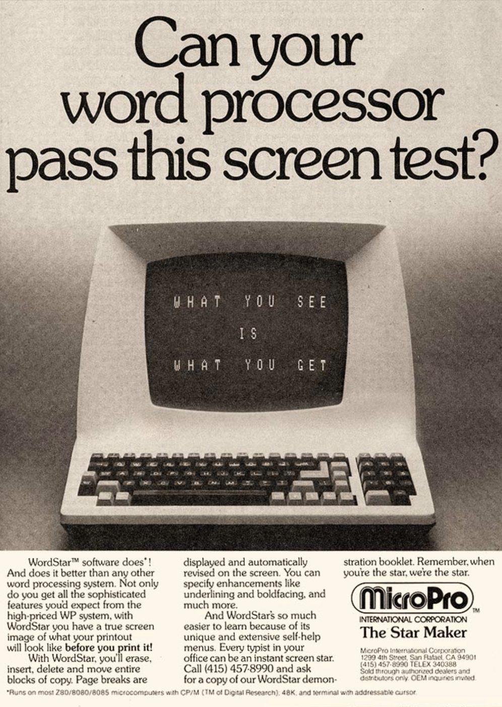
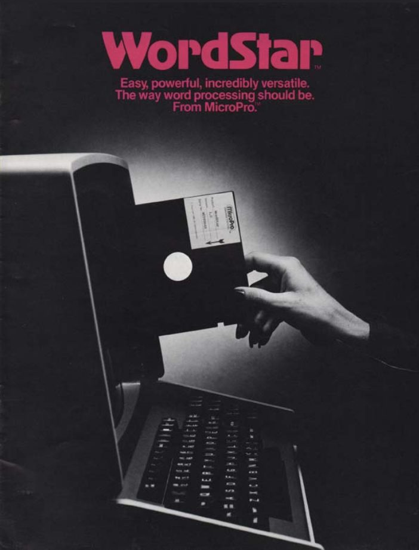
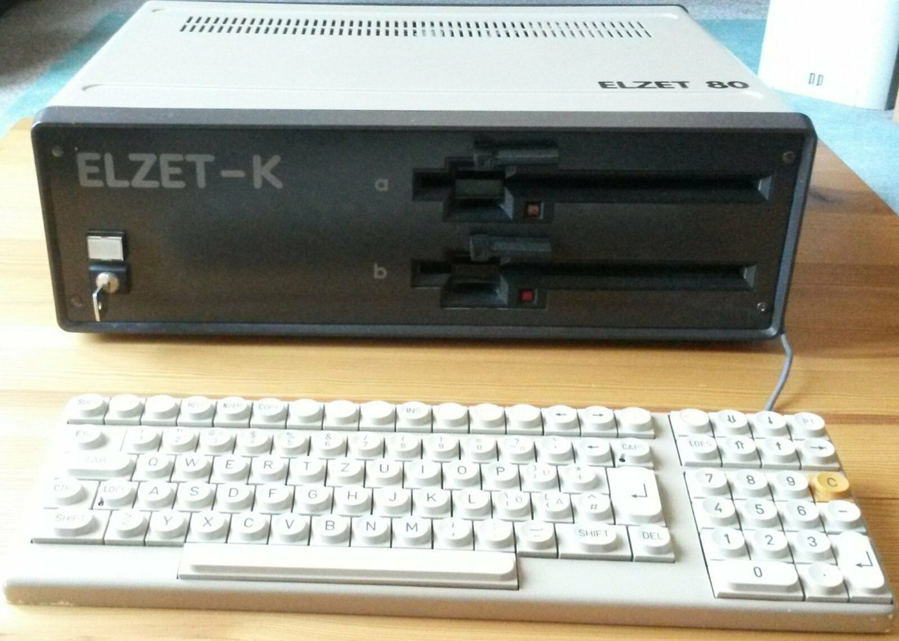
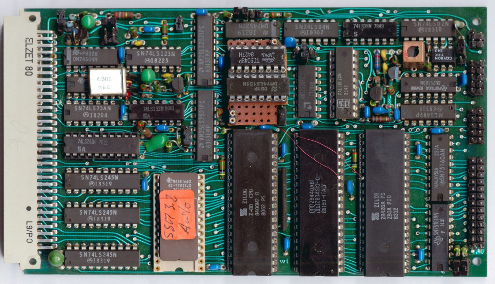
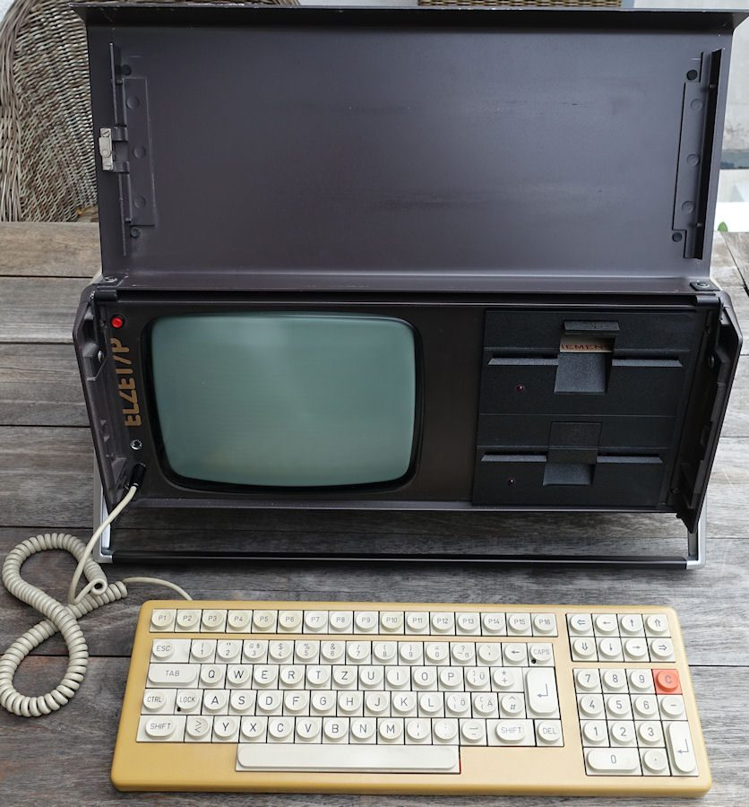
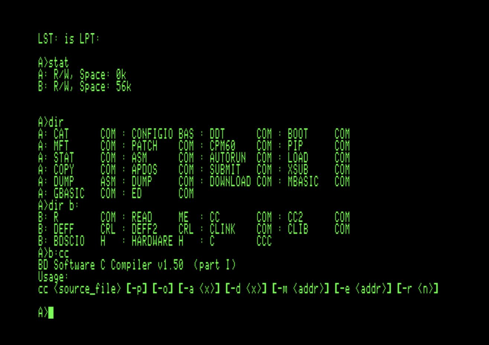
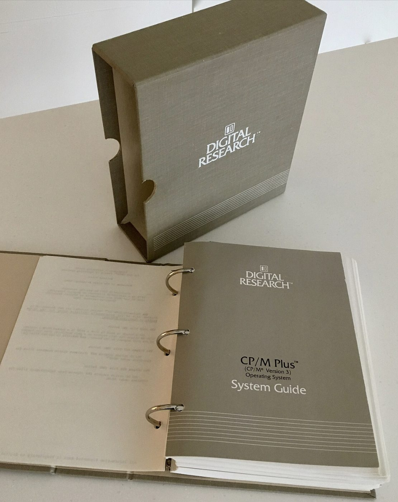

# Wie dieses Lehrwerk entstand

Die ursprüngliche Fassung dieses Lehrmaterials entstand im:

**Februar 1984**

Damals wurden die Grundlagen für eine persönliche Sammlung von Ausbildungsunterlagen über:

- Elektrizität
- Hochfrequenztechnik
- Funkwellenausbreitung
- Antennen
- Sender und Empfänger
- Funkbetrieb

zusammengestellt.

Getippt wurde das ursprüngliche Manuskript auf einem selbstgebauten Computer mit einem Zilog-Z80-Prozessor, unter dem Betriebssystem CP/M 2.2, mit der Textverarbeitung WordStar der Firma MicroPro, damals eine der verbreitetsten Textverarbeitungen im professionellen und semiprofessionellen Umfeld.

Mein selbstgebauter Computer war ein ELZET 80, aufgebaut aus Bausätzen der Firma Elektronikladen Detmold. Meine eigenen ELZET 80 habe ich selbst zusammengebaut. Damals hat mein Vater viele Geräte finanziert und nach Hause gebracht.

<figure markdown>
  { width="55%" loading=lazy }
  <figcaption>Werbung für WordStar von MicroPro: "What you see is what you get". Quelle: Internet, Urheber unbekannt. Von der Lizenz CC BY 4.0 ausgenommen.</figcaption>
</figure>

<figure markdown>
  { width="45%" loading=lazy }
  <figcaption>Titelseite eines WordStar-Prospekts. Quelle: Internet, Urheber unbekannt. Von der Lizenz CC BY 4.0 ausgenommen.</figcaption>
</figure>

<figure markdown>
  { width="80%" loading=lazy }
  <figcaption>Mein ELZET 80 im Gehäuse «Elzet-K»: ein Computer mit 8-Zoll-Diskettenlaufwerken und einer eingebauten Festplatte mit 5 Megabyte. Foto: Familie Sauder</figcaption>
</figure>

<figure markdown>
  { width="90%" loading=lazy }
  <figcaption>Die CPU-Karte des ELZET 80 mit dem Zilog-Z80-Prozessor. Diese Karte habe ich selbst aus einem Bausatz zusammengebaut. Foto: Familie Sauder</figcaption>
</figure>

<figure markdown>
  { width="55%" loading=lazy }
  <figcaption>Der ELZET-P (Portable) meines Vaters, mit 5,25-Zoll-Laufwerken. Ich wohnte im selben Haus und habe oft daran gearbeitet. Als mein Vater ein neues System kaufte, habe ich ihn später übernommen. Foto: Familie Sauder</figcaption>
</figure>

## So entstand das Original: Karopapier, Bleistift und Mortadella

Gelernt habe ich damals unter anderem aus dem Buch «Amateurfunktechnik» von Heini Sutz und Ueli Hofer. Daraus habe ich viele Notizen gemacht und Lernzusammenfassungen getippt. Sie bilden den Kern des Lehrwerks.

Die Skizzen von damals waren ein Sammelsurium aus Karopapier und Makulatur, auf deren Rückseite ich gezeichnet habe. Ich zeichnete sie mit Bleistift, korrigierte, radierte aus und zeichnete neu. Manche Blätter haben sogar Mortadella-Flecken.

Dann habe ich die Skizzen fotokopiert, ausgeschnitten und auf die Kopiervorlage geklebt. Alles andere war mit der Schreibmaschine geschrieben. Im Copy Center wurde das Ganze vervielfältigt und mehrfach gelocht. So ging das damals.

## Die alten Dateien wieder lesbar machen

Über vierzig Jahre später mussten diese Dateien für die vorliegende Neuauflage zunächst wieder lesbar gemacht werden. Dazu wurde eine CP/M-Emulation auf einem heutigen MacBook zum Laufen gebracht, um die alten WordStar-Dokumente zu öffnen und ihren Inhalt in ein zeitgemäss nutzbares Format zu überführen. Erst danach konnte die inhaltliche und didaktische Überarbeitung beginnen.

Ich habe dazu unter CP/M einen Batch geschrieben. Er öffnete sämtliche Dateien und speicherte sie ohne WordStar-Formatierung wieder ab. Das ging recht zügig, und so konnte ich später 350 bis 400 Dateien wieder lesen.

Das hätte wohl auch eine KI erledigen können. Ich wollte es aber nicht. Ich wollte CP/M wieder fühlen und wieder erleben, wie es ist, eine Datei zu kopieren und dafür den Befehl PIP zu benutzen.

<figure markdown>
  { width="70%" loading=lazy }
  <figcaption>So sah das unter CP/M aus: Verzeichnis mit dem Programm PIP. Quelle: Internet, Urheber unbekannt. Von der Lizenz CC BY 4.0 ausgenommen.</figcaption>
</figure>

<figure markdown>
  { width="50%" loading=lazy }
  <figcaption>Das Systemhandbuch zu CP/M Plus von Digital Research. Quelle: Internet, Urheber unbekannt. Von der Lizenz CC BY 4.0 ausgenommen.</figcaption>
</figure>

## Skizzen einscannen und neu zeichnen lassen

Ich habe alle Skizzen noch in einem Umschlag gefunden. Es waren früher weitaus mehr. Heute sind vielleicht 10 bis 20 davon vorhanden. Der Rest musste neu gezeichnet werden.

Ich habe die Skizzen mit meinem Epson-Scanner am Mac eingescannt und von einer KI sauber nachzeichnen lassen. Die neuen Zeichnungen sind wieder im Bleistiftstil, aber viel schöner geworden. Die KI hat das sehr gut gemacht, ich musste kaum etwas korrigieren.

Die Abbildungen der heutigen Fassung sind also neu erstellt und neu beschriftet. Sie folgen bewusst keinem modernen Infografikstil, sondern den einfachen Zeichnungen aus Ausbildungsunterlagen der 1980er-Jahre. Sie sollen einen technischen Sachverhalt erklären und nicht bloss gut aussehen.

## Der Amateurfunk in der Schweiz von 1984

Als dieses Lehrmaterial ursprünglich entstand, existierte das heutige BAKOM noch nicht. Zuständig für Funkkonzessionen waren die PTT, die schweizerischen Post-, Telefon- und Telegrafenbetriebe, über ihre Kreistelephondirektionen, die später zu Fernmeldekreisdirektionen wurden.

Auch die heutige zweistufige Einteilung in HB3 und HB9 gab es damals noch nicht, diese Struktur wurde erst später im Rahmen der CEPT-Harmonisierung eingeführt. Stattdessen bestand ein anderes, ebenfalls zweistufiges System:

**UKW-Amateur**

Diese Konzession erlaubte den Betrieb auf den UKW-Bändern, damals in erster Linie 2 m, später kam mit der Zeit auch 70 cm dazu. Für diese Konzession war keine Morseprüfung erforderlich.

**Kurzwellenamateur**

Diese umfassendere Konzession, oft auch als «Vollamateur» bezeichnet, berechtigte zusätzlich zum Betrieb auf den Kurzwellenbändern. Voraussetzung dafür war neben der technischen und betrieblichen Prüfung zusätzlich eine Morseprüfung, das Aufnehmen und Geben von Telegrafiezeichen in vorgegebenem Tempo.

Ein UKW-Amateur, der später zusätzlich die Kurzwellenbänder nutzen wollte, musste demnach die Morseprüfung nachholen. Dieses Prinzip, volle Kurzwellenrechte nur in Verbindung mit einer Morseprüfung, war international lange Zeit üblich und wurde in der Schweiz wie auch anderswo erst deutlich später aufgegeben.

## Persönlicher Anlass der Neuauflage

Die Neuaufarbeitung dieses Lehrmaterials entstand in erster Linie aus einem persönlichen Anliegen. Ich habe beschlossen, die schweizerische Amateurfunkprüfung nochmals abzulegen, nicht weil ich damit ein bestimmtes berufliches oder technisches Ziel verfolge, sondern weil ich mein früheres Wissen auffrischen und mich erneut intensiv mit einem anspruchsvollen technischen Fachgebiet beschäftigen möchte.

Mit zunehmendem Alter und insbesondere seit einer COVID-Erkrankung vor einigen Jahren habe ich festgestellt, dass sich mein Erinnerungsvermögen und meine geistige Belastbarkeit verändert haben. Wissen, das früher rasch verfügbar war, muss heute teilweise bewusster erarbeitet und gefestigt werden. Für mich ist die erneute Vorbereitung auf die Amateurfunkprüfung deshalb auch eine Form des geistigen Trainings.

Das Lernen von Elektrotechnik, Funktechnik, Mathematik und den damit verbundenen Zusammenhängen fordert Konzentration, Erinnerungsvermögen, logisches Denken und die Fähigkeit, bereits vorhandenes Wissen neu miteinander zu verknüpfen. Genau darin liegt für mich ein wesentlicher Zweck dieses Projekts:

> **Das Gehirn bewusst zu fordern, vorhandenes Wissen wieder freizulegen und durch neues Lernen geistig in Bewegung zu bleiben.**

Aus dieser zunächst persönlichen Aufgabe entwickelte sich nach und nach der Anspruch, die Unterlagen so aufzubereiten, dass daraus wieder ein vollständiges, verständliches und zeitgemässes Lehrwerk entsteht, das auch anderen Interessierten bei der Vorbereitung auf die Amateurfunkprüfung nützlich sein kann.

Als fachliche Grundlage dienten insbesondere Unterlagen der damaligen schweizerischen:

**PTT, Post-, Telefon- und Telegrafenbetriebe**

einschliesslich Ausbildungs- und Informationsmaterial der damaligen **Kreistelephondirektionen**, die ab 1983 als **Fernmeldekreisdirektionen** bezeichnet wurden.

Ergänzend wurde internationale Amateurfunk-Fachliteratur verwendet, insbesondere Veröffentlichungen der:

**ARRL, American Radio Relay League**

Die damalige Fassung entsprach dem technischen und regulatorischen Stand der frühen 1980er-Jahre.

---

## Neuaufarbeitung 2026

Im:

**Januar bis ca. August 2026**

wurde das Lehrmaterial grundlegend neu aufgebaut.

Dabei wurde nicht lediglich der ursprüngliche Text sprachlich überarbeitet.

Die gesamte Struktur wurde neu geordnet, fachlich überprüft und zu einem zusammenhängenden Lehrgang für die heutige schweizerische Amateurfunkausbildung ausgebaut.

Ziel war es, aus historischen Ausbildungsnotizen ein modernes Lehrwerk zu entwickeln, das technisch nachvollziehbar, prüfungsrelevant, praxisbezogen und systematisch aufgebaut ist und auch ohne umfangreiche Vorkenntnisse verständlich bleibt.

Dabei wurden veraltete technische oder regulatorische Angaben nicht ungeprüft übernommen.

### Quellen sammeln, ordnen und redigieren

Ich habe unzählige Quellen zusammengesucht und seitenweise Dokumente von damals eingescannt. Dazu kam viel Material aus Büchern von damals, auch aus dem Buch «Amateurfunktechnik» von Heini Sutz und Ueli Hofer (1971). All das ist eingeflossen.

Die vielen Zettel habe ich eingelesen und mit der KI aussortieren lassen. Ich habe der KI gesagt, wie ich Struktur und Aufbau haben will, und sie hat die Unterlagen dann zurechtgezupft. Meine Texte hat die KI nach meinen Vorgaben (Prompts) neu formuliert. Danach habe ich Dutzende Redigierdurchgänge gemacht, bis ich zufrieden war.

### Version 2 und Open Source

Jetzt sind wir bei Version 2. Wieder hilft mir eine KI, diesmal Claude, das Ganze sauber in Form zu bringen. Ich habe beschlossen, ein Open-Source-Projekt daraus zu machen, damit möglichst viele Menschen davon profitieren können.

---

*© 1984 bis 2026 FerienBSD aka Marcel Sauder. Lizenz: [CC BY 4.0](https://creativecommons.org/licenses/by/4.0/deed.de). Du darfst die Inhalte teilen und bearbeiten, wenn du den Urheber nennst.*
