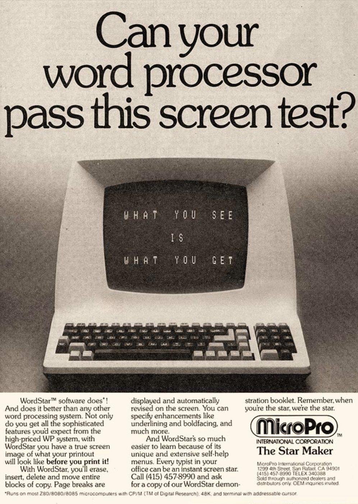
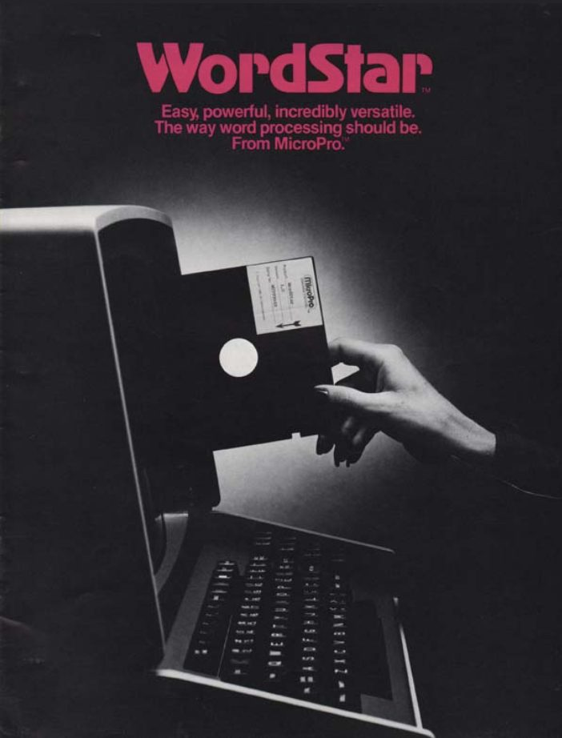
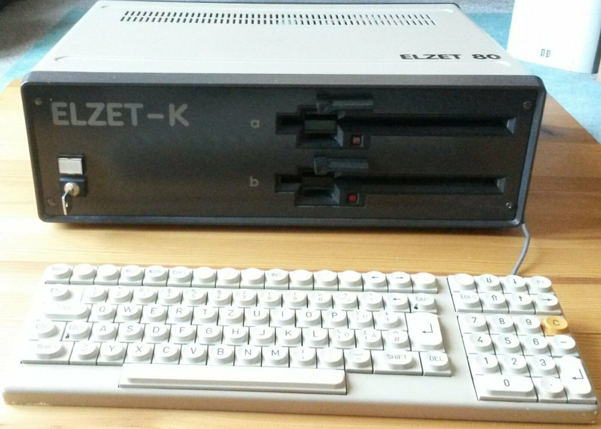
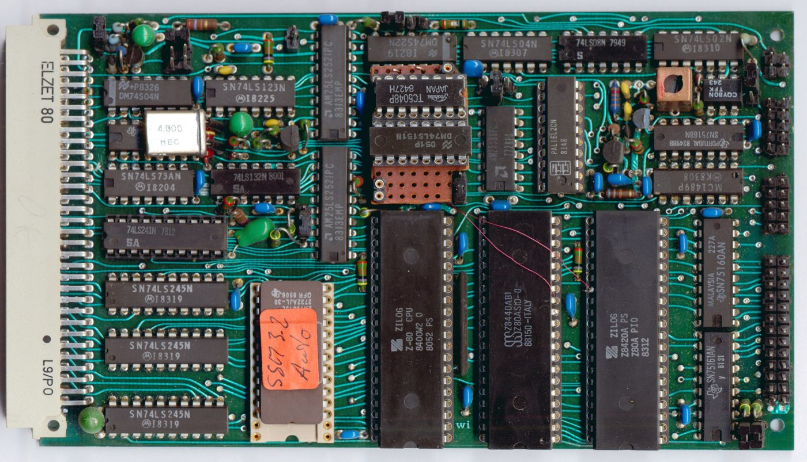
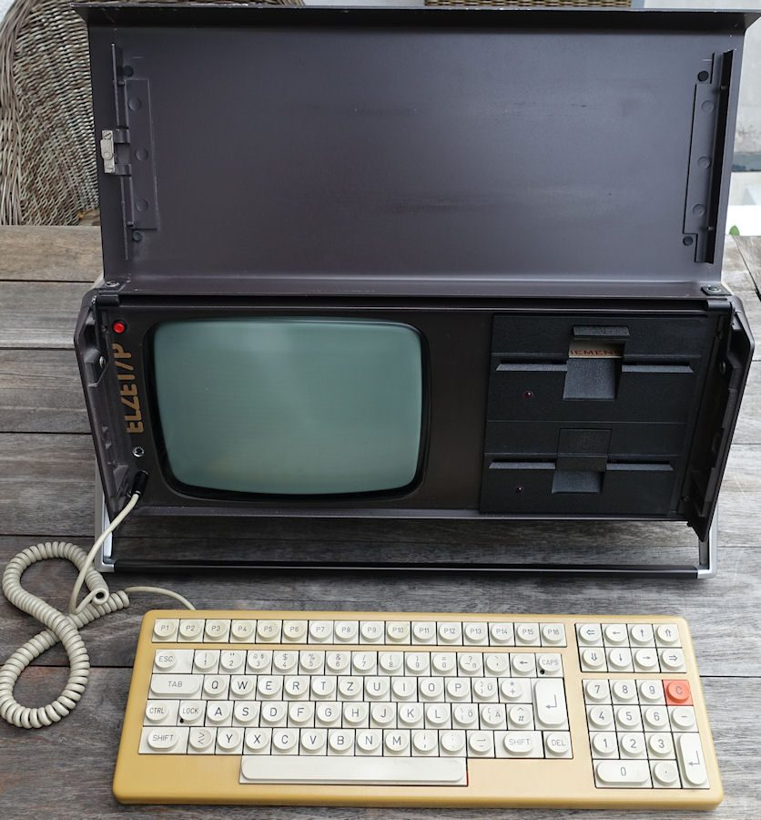
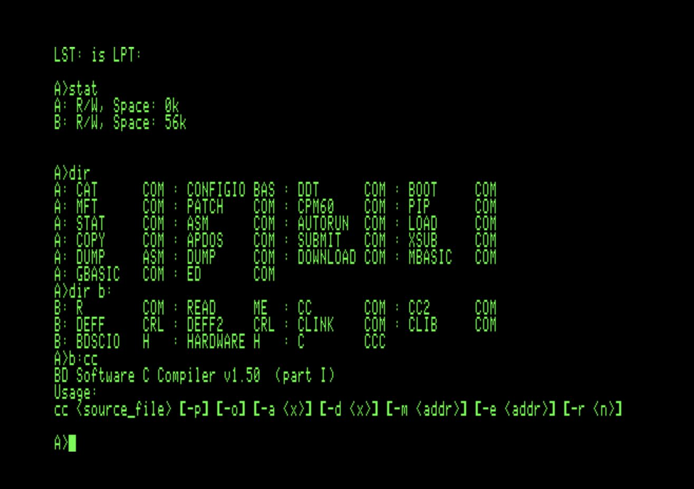
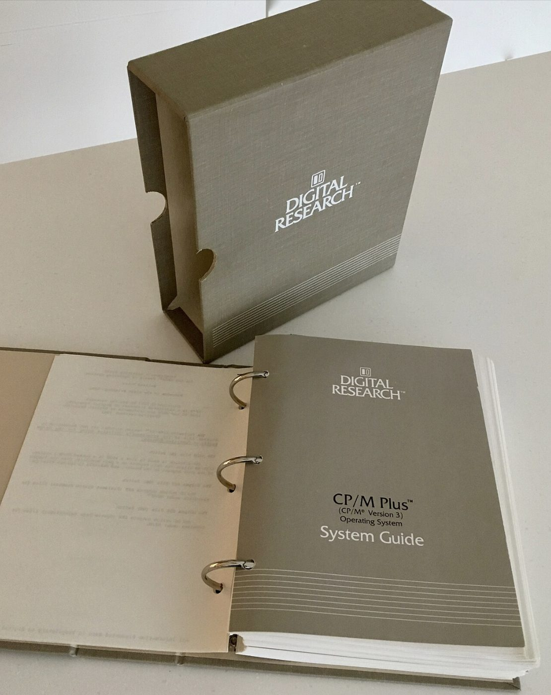

# Über dieses Lehrwerk

## Amateurfunk verstehen

**Technische Grundlagen für Ausbildung, Experiment und Praxis**

Dieses Lehrwerk vermittelt die technischen und betrieblichen Grundlagen des Amateurfunks mit Schwerpunkt auf der schweizerischen Ausbildung und der Vorbereitung auf die Amateurfunkprüfung.

Es richtet sich insbesondere an angehende Funkamateurinnen und Funkamateure, die den Stoff nicht lediglich für eine Prüfung auswendig lernen, sondern die technischen Zusammenhänge verstehen möchten.

Der Schwerpunkt liegt auf der vollständigen schweizerischen Amateurfunkprüfung **HB9**. Wo es didaktisch sinnvoll ist, wird zusätzlich darauf hingewiesen, welche Inhalte für die **HB3-NOVICE-Prüfung** typischerweise weniger vertieft behandelt werden.

> **Wichtig:** Die im Lehrwerk verwendeten Hinweise wie «HB9-Vertiefung» sind didaktische Kennzeichnungen. Sie stellen keine offizielle punktweise Abgrenzung des BAKOM-Prüfungsstoffes zwischen HB3 und HB9 dar. Das BAKOM legt fest, dass die technischen und rechnerischen Fragen für HB3 weniger komplex sind.

---

# Entstehung

Die ursprüngliche Fassung dieses Lehrmaterials entstand im:

**Februar 1984**

Damals wurden die Grundlagen für eine persönliche Sammlung von Ausbildungsunterlagen über:

- Elektrizität
- Hochfrequenztechnik
- Funkwellenausbreitung
- Antennen
- Sender und Empfänger
- Funkbetrieb

zusammengestellt.

Getippt wurde das ursprüngliche Manuskript auf einem selbstgebauten Computer mit einem Zilog-Z80-Prozessor, unter dem Betriebssystem CP/M 2.2, mit der Textverarbeitung WordStar der Firma MicroPro, damals eine der verbreitetsten Textverarbeitungen im professionellen und semiprofessionellen Umfeld.

<figure markdown>
  { width="55%" loading=lazy }
  <figcaption>Werbung für WordStar von MicroPro: "What you see is what you get". Bildrechte: offen</figcaption>
</figure>

<figure markdown>
  { width="45%" loading=lazy }
  <figcaption>Titelseite eines WordStar-Prospekts. Bildrechte: offen</figcaption>
</figure>

<figure markdown>
  { width="80%" loading=lazy }
  <figcaption>Der Elzet-K: ein Computer mit 8-Zoll-Diskettenlaufwerken und einer eingebauten Festplatte mit 5 Megabyte. Bildrechte: offen</figcaption>
</figure>

<figure markdown>
  { width="90%" loading=lazy }
  <figcaption>Die CPU-Karte (Elzet 80) mit dem Zilog-Z80-Prozessor. Diese Karte habe ich selbst zusammengebaut. Bildrechte: offen</figcaption>
</figure>

<figure markdown>
  { width="55%" loading=lazy }
  <figcaption>Später kam der Elzet-P (Portable) mit 5,25-Zoll-Laufwerken. Bildrechte: offen</figcaption>
</figure>

## So entstand das Original: Karopapier, Bleistift und Mortadella

Die Skizzen von damals waren ein Sammelsurium aus Karopapier und Makulatur, auf deren Rückseite ich gezeichnet habe. Ich zeichnete sie mit Bleistift, korrigierte, radierte aus und zeichnete neu. Manche Blätter haben sogar Mortadella-Flecken.

Dann habe ich die Skizzen fotokopiert, ausgeschnitten und auf die Kopiervorlage geklebt. Alles andere war mit der Schreibmaschine geschrieben. Im Copy Center wurde das Ganze vervielfältigt und mehrfach gelocht. So ging das damals.

## Die alten Dateien wieder lesbar machen

Über vierzig Jahre später mussten diese Dateien für die vorliegende Neuauflage zunächst wieder lesbar gemacht werden. Dazu wurde eine CP/M-Emulation auf einem heutigen MacBook zum Laufen gebracht, um die alten WordStar-Dokumente zu öffnen und ihren Inhalt in ein zeitgemäss nutzbares Format zu überführen. Erst danach konnte die inhaltliche und didaktische Überarbeitung beginnen.

Ich habe dazu unter CP/M einen Batch geschrieben. Er öffnete sämtliche Dateien und speicherte sie ohne WordStar-Formatierung wieder ab. Das ging recht zügig, und so konnte ich später 350 bis 400 Dateien wieder lesen.

Das hätte wohl auch eine KI erledigen können. Ich wollte es aber nicht. Ich wollte CP/M wieder fühlen und wieder erleben, wie es ist, eine Datei zu kopieren und dafür den Befehl PIP zu benutzen.

<figure markdown>
  { width="70%" loading=lazy }
  <figcaption>So sah das unter CP/M aus: Verzeichnis mit dem Programm PIP. Bildrechte: offen</figcaption>
</figure>

<figure markdown>
  { width="50%" loading=lazy }
  <figcaption>Das Systemhandbuch zu CP/M Plus von Digital Research. Bildrechte: offen</figcaption>
</figure>

## Skizzen einscannen und neu zeichnen lassen

Ich habe alle Skizzen noch in einem Umschlag gefunden. Es waren früher weitaus mehr. Heute sind vielleicht 10 bis 20 davon vorhanden. Der Rest musste neu gezeichnet werden.

Ich habe die Skizzen mit meinem Epson-Scanner am Mac eingescannt und von einer KI sauber nachzeichnen lassen. Die neuen Zeichnungen sind wieder im Bleistiftstil, aber viel schöner geworden. Die KI hat das sehr gut gemacht, ich musste kaum etwas korrigieren.

Die Abbildungen der heutigen Fassung sind also neu erstellt und neu beschriftet. Sie folgen bewusst keinem modernen Infografikstil, sondern den einfachen Zeichnungen aus Ausbildungsunterlagen der 1980er-Jahre. Sie sollen einen technischen Sachverhalt erklären und nicht bloss gut aussehen.

## Der Amateurfunk in der Schweiz von 1984

Als dieses Lehrmaterial ursprünglich entstand, existierte das heutige BAKOM noch nicht. Zuständig für Funkkonzessionen waren die PTT, die schweizerischen Post-, Telefon- und Telegrafenbetriebe, über ihre Kreistelephondirektionen, die später zu Fernmeldekreisdirektionen wurden.

Auch die heutige zweistufige Einteilung in HB3 und HB9 gab es damals noch nicht, diese Struktur wurde erst später im Rahmen der CEPT-Harmonisierung eingeführt. Stattdessen bestand ein anderes, ebenfalls zweistufiges System:

**UKW-Amateur**

Diese Konzession erlaubte den Betrieb auf den UKW-Bändern, damals in erster Linie 2 m, später kam mit der Zeit auch 70 cm dazu. Für diese Konzession war keine Morseprüfung erforderlich.

**Kurzwellenamateur**

Diese umfassendere Konzession, oft auch als «Vollamateur» bezeichnet, berechtigte zusätzlich zum Betrieb auf den Kurzwellenbändern. Voraussetzung dafür war neben der technischen und betrieblichen Prüfung zusätzlich eine Morseprüfung, das Aufnehmen und Geben von Telegrafiezeichen in vorgegebenem Tempo.

Ein UKW-Amateur, der später zusätzlich die Kurzwellenbänder nutzen wollte, musste demnach die Morseprüfung nachholen. Dieses Prinzip, volle Kurzwellenrechte nur in Verbindung mit einer Morseprüfung, war international lange Zeit üblich und wurde in der Schweiz wie auch anderswo erst deutlich später aufgegeben.

## Persönlicher Anlass der Neuauflage

Die Neuaufarbeitung dieses Lehrmaterials entstand in erster Linie aus einem persönlichen Anliegen. Ich habe beschlossen, die schweizerische Amateurfunkprüfung nochmals abzulegen, nicht weil ich damit ein bestimmtes berufliches oder technisches Ziel verfolge, sondern weil ich mein früheres Wissen auffrischen und mich erneut intensiv mit einem anspruchsvollen technischen Fachgebiet beschäftigen möchte.

Mit zunehmendem Alter und insbesondere seit einer COVID-Erkrankung vor einigen Jahren habe ich festgestellt, dass sich mein Erinnerungsvermögen und meine geistige Belastbarkeit verändert haben. Wissen, das früher rasch verfügbar war, muss heute teilweise bewusster erarbeitet und gefestigt werden. Für mich ist die erneute Vorbereitung auf die Amateurfunkprüfung deshalb auch eine Form des geistigen Trainings.

Das Lernen von Elektrotechnik, Funktechnik, Mathematik und den damit verbundenen Zusammenhängen fordert Konzentration, Erinnerungsvermögen, logisches Denken und die Fähigkeit, bereits vorhandenes Wissen neu miteinander zu verknüpfen. Genau darin liegt für mich ein wesentlicher Zweck dieses Projekts:

> **Das Gehirn bewusst zu fordern, vorhandenes Wissen wieder freizulegen und durch neues Lernen geistig in Bewegung zu bleiben.**

Aus dieser zunächst persönlichen Aufgabe entwickelte sich nach und nach der Anspruch, die Unterlagen so aufzubereiten, dass daraus wieder ein vollständiges, verständliches und zeitgemässes Lehrwerk entsteht, das auch anderen Interessierten bei der Vorbereitung auf die Amateurfunkprüfung nützlich sein kann.

Als fachliche Grundlage dienten insbesondere Unterlagen der damaligen schweizerischen:

**PTT, Post-, Telefon- und Telegrafenbetriebe**

einschliesslich Ausbildungs- und Informationsmaterial der damaligen **Kreistelephondirektionen**, die ab 1983 als **Fernmeldekreisdirektionen** bezeichnet wurden.

Ergänzend wurde internationale Amateurfunk-Fachliteratur verwendet, insbesondere Veröffentlichungen der:

**ARRL, American Radio Relay League**

Die damalige Fassung entsprach dem technischen und regulatorischen Stand der frühen 1980er-Jahre.

---

# Neuaufarbeitung 2026

Im:

**Januar bis ca. August 2026**

wurde das Lehrmaterial grundlegend neu aufgebaut.

Dabei wurde nicht lediglich der ursprüngliche Text sprachlich überarbeitet.

Die gesamte Struktur wurde neu geordnet, fachlich überprüft und zu einem zusammenhängenden Lehrgang für die heutige schweizerische Amateurfunkausbildung ausgebaut.

Ziel war es, aus historischen Ausbildungsnotizen ein modernes Lehrwerk zu entwickeln, das technisch nachvollziehbar, prüfungsrelevant, praxisbezogen und systematisch aufgebaut ist und auch ohne umfangreiche Vorkenntnisse verständlich bleibt.

Dabei wurden veraltete technische oder regulatorische Angaben nicht ungeprüft übernommen.

## Quellen sammeln, ordnen und redigieren

Ich habe unzählige Quellen zusammengesucht und seitenweise Dokumente von damals eingescannt. Dazu kam viel Material aus Büchern von damals, auch aus einem Buch von 1971, das Heini Stutz und Ueli Hofer verfasst haben. All das ist eingeflossen.

Die vielen Zettel habe ich eingelesen und mit der KI aussortieren lassen. Ich habe der KI gesagt, wie ich Struktur und Aufbau haben will, und sie hat die Unterlagen dann zurechtgezupft. Meine Texte hat die KI nach meinen Vorgaben (Prompts) neu formuliert. Danach habe ich Dutzende Redigierdurchgänge gemacht, bis ich zufrieden war.

## Version 2 und Open Source

Jetzt sind wir bei Version 2. Wieder hilft mir eine KI, diesmal Claude, das Ganze sauber in Form zu bringen. Ich habe beschlossen, ein Open-Source-Projekt daraus zu machen, damit möglichst viele Menschen davon profitieren können.

---

# Schweizer Ausrichtung

Dieses Lehrwerk ist bewusst auf die Verhältnisse in der:

**Schweiz**

ausgerichtet.

Für prüfungsbezogene und regulatorische Aussagen haben deshalb schweizerische Quellen Vorrang.

Die Quellen werden grundsätzlich nach folgender Priorität verwendet:

1. **Bundesamt für Kommunikation BAKOM**
2. **USKA und schweizerische Amateurfunkpraxis**
3. **schweizerische Amateurfunkvereine und Ausbildungsunterlagen**
4. **internationale technische Fachliteratur**
5. **ARRL als ergänzende internationale Fachquelle**

---

# Massgebende aktuelle Quellen

## Bundesamt für Kommunikation BAKOM

Für den aktuellen schweizerischen Prüfungs- und Rechtsrahmen bilden insbesondere folgende Unterlagen die Grundlage:

- Prüfungsvorschriften Amateurfunk
- aktuelle BAKOM-Formelsammlung
- aktuelle BAKOM-Hilfstabellen
- Merkblatt Amateurfunk
- aktuelle schweizerische Frequenzzuweisungen
- relevante Bestimmungen über Rufzeichen, Funkanlagen und Betriebsrechte

Diese Unterlagen besitzen für dieses Lehrwerk Vorrang vor älteren:

- Fragenkatalogen
- Büchern
- Vereinsunterlagen
- Webseiten
- historischen PTT-Dokumenten

wenn es um den heutigen Rechts- oder Prüfungsstand geht.

---

# Historische Prüfungsfragen

Ältere schweizerische Fragenkataloge werden teilweise ergänzend verwendet.

Sie sind hilfreich, um zu erkennen, welche technischen Grundfragen in der schweizerischen Amateurfunkausbildung traditionell eine Rolle spielen.

Sie werden jedoch **nicht als aktuelle Rechtsquelle behandelt**.

Das betrifft insbesondere ältere Angaben zu:

- Frequenzbereichen
- HB3-Rechten
- Sendeleistungen
- NIS
- Rufzeichen
- Betriebsbewilligungen
- Gerätevorschriften

Bei solchen Themen zählt immer der aktuelle Stand der zuständigen Behörden.

---

# USKA und schweizerische Amateurfunkpraxis

Die:

**Union Schweizerischer Kurzwellen-Amateure, USKA**

sowie schweizerische Amateurfunkvereine sind wichtige Quellen für:

- praktische Betriebserfahrung
- Bandplanung
- Relaisbetrieb
- Antennenpraxis
- Ausbildung
- schweizerische Amateurfunktradition

Wo zwischen einer freiwilligen betrieblichen Empfehlung und einer gesetzlichen Vorschrift unterschieden werden muss, wird dies im Lehrwerk entsprechend gekennzeichnet.

Ein:

**Bandplan**

ist beispielsweise nicht dasselbe wie eine gesetzliche Frequenzzuteilung.

---

# Internationale Fachliteratur

Internationale Fachliteratur wird dort verwendet, wo sie technische Zusammenhänge vertieft oder besonders gut erklärt.

Eine wichtige historische und fachliche Quelle ist die Literatur der:

**ARRL, American Radio Relay League**

Sie wird in diesem Lehrwerk jedoch ergänzend und nicht als Grundlage für schweizerische Rechtsfragen verwendet.

---

# Autor

**Marcel Sauder**

Ursprüngliche Zusammenstellung:

**Februar 1984**

Grundlegende Überarbeitung und Neuaufbau:

**August 2026, Schweiz**

---

# Quellenhinweis

Historische Grundlagen:

- schweizerische PTT-Unterlagen
- Unterlagen damaliger Kreistelephondirektionen beziehungsweise späterer Fernmeldekreisdirektionen
- Amateurfunk-Fachliteratur der frühen 1980er-Jahre
- ARRL-Fachliteratur

Grundlagen der heutigen Fassung:

- aktuelle Unterlagen des Bundesamtes für Kommunikation BAKOM
- aktuelle schweizerische Amateurfunkvorschriften
- aktuelle BAKOM-Formelsammlung
- aktuelle BAKOM-Hilfstabellen
- schweizerische Amateurfunkpraxis
- USKA
- internationale technische Fachliteratur
- ARRL als ergänzende Fachquelle

Ältere schweizerische Prüfungsfragen und Ausbildungsunterlagen werden ausschliesslich ergänzend verwendet und bei aktuellen regulatorischen Aussagen nicht über die heutigen offiziellen BAKOM-Unterlagen gestellt.

---

# Schlussgedanke

Amateurfunk verbindet:

**Physik, Elektronik, Funktechnik, Experiment und Kommunikation.**

Die Technik lässt sich am besten verstehen, wenn Theorie und praktische Erfahrung zusammenkommen.

Dieses Lehrwerk soll deshalb nicht nur zur Prüfung führen, sondern dazu beitragen, dass aus einzelnen Formeln und Bauteilen nach und nach ein vollständiges Bild entsteht:

**vom Elektron im Leiter bis zur Funkverbindung über Tausende Kilometer.**

# Navigation

[↑ Zurück zum Inhaltsverzeichnis](../hb9/einfuehrung.md)

[Kapitel 1: Elektrische Grundlagen →](../hb9/01-elektrische-grundlagen.md)

---

*© 1984 bis 2026 FerienBSD aka Marcel Sauder. Lizenz: [CC BY 4.0](https://creativecommons.org/licenses/by/4.0/deed.de). Du darfst die Inhalte teilen und bearbeiten, wenn du den Urheber nennst.*
