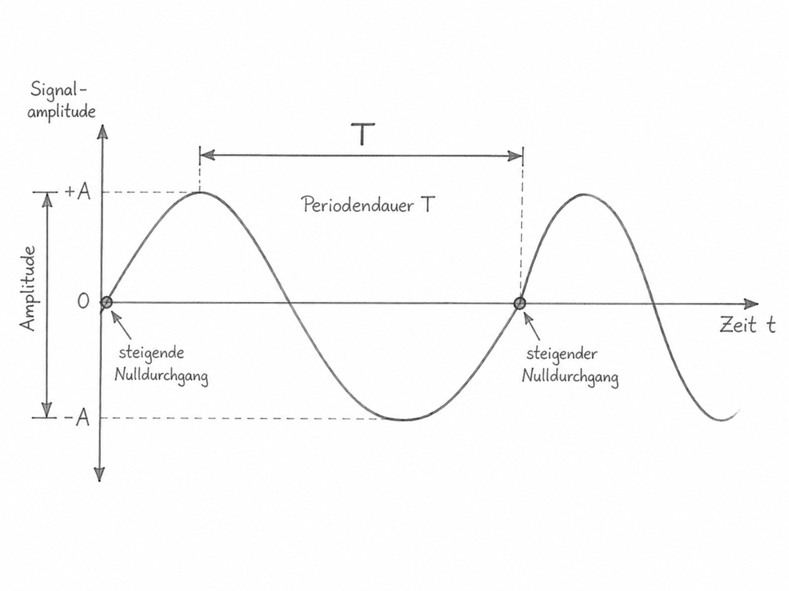
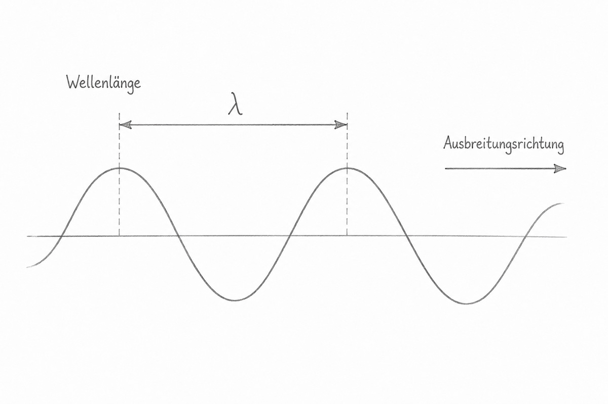

# Kapitel 2: Frequenz, Periodendauer und Wellenlänge

## Lernziele

Nach diesem Kapitel solltest du:

- erklären können, was eine periodische Schwingung ist
- Frequenz und Periodendauer unterscheiden können
- Hertz, Kilohertz, Megahertz und Gigahertz sicher umrechnen können
- den Zusammenhang zwischen Frequenz und Periodendauer verstehen und berechnen können
- erklären können, was die Wellenlänge \(\lambda\) bedeutet
- den Zusammenhang zwischen Frequenz, Wellenlänge und Ausbreitungsgeschwindigkeit verstehen
- aus einer Frequenz die Wellenlänge berechnen können
- aus einer Wellenlänge die Frequenz berechnen können
- verstehen, weshalb hohe Frequenzen kurze Wellenlängen besitzen
- erklären können, weshalb die Bezeichnungen 80-m-, 20-m- oder 2-m-Band nur ungefähre Wellenlängenbereiche bezeichnen
- den späteren Zusammenhang zwischen Wellenlänge und Antennenabmessungen verstehen

> **Hinweis zu HB3 und HB9:**
> Frequenz, Periodendauer und Wellenlänge gehören zu den grundlegenden Zusammenhängen der Elektro- und Funktechnik. Für HB3 sind die technischen und rechnerischen Fragen weniger komplex als für HB9. Die Kennzeichnung **HB9-Vertiefung** dient in diesem Lehrwerk als Lernhilfe.

## Formelzeichen und Symbole

<table>
<thead>
<tr>
<th>Zeichen</th>
<th>Name</th>
<th>Bedeutung</th>
<th>Einheit</th>
</tr>
</thead>
<tbody>
<tr>
<td>\(f\)</td>
<td>Frequenz</td>
<td>Anzahl vollständiger Perioden pro Sekunde</td>
<td>Hz</td>
</tr>
<tr>
<td>\(T\)</td>
<td>Periodendauer</td>
<td>Zeit für eine vollständige Periode</td>
<td>s</td>
</tr>
<tr>
<td>\(\lambda\)</td>
<td>Lambda</td>
<td>Wellenlänge</td>
<td>m</td>
</tr>
<tr>
<td>\(c\)</td>
<td>c</td>
<td>Ausbreitungsgeschwindigkeit der elektromagnetischen Welle</td>
<td>m/s</td>
</tr>
<tr>
<td>\(c_0\)</td>
<td>c null</td>
<td>Lichtgeschwindigkeit im Vakuum</td>
<td>m/s</td>
</tr>
</tbody>
</table>

Der griechische Buchstabe:

\[
\lambda
\]

wird **Lambda** ausgesprochen.

Er bezeichnet in diesem Lehrwerk die Wellenlänge.

## Der rote Faden

Dieses Kapitel verbindet drei Grössen:

**Frequenz**

→ Wie oft schwingt etwas pro Sekunde?

**Periodendauer**

→ Wie lange dauert eine vollständige Schwingung?

**Wellenlänge**

→ Welche Strecke legt eine Welle während einer vollständigen Schwingung zurück?

Die beiden wichtigsten Zusammenhänge sind:

\[
T=\frac{1}{f}
\]

und:

\[
c=f\cdot\lambda
\]

Daraus folgt:

> **Je höher die Frequenz, desto kürzer sind Periodendauer und Wellenlänge.**

---

# Periodische Vorgänge

Ein Vorgang ist **periodisch**, wenn er sich in regelmässigen Zeitabständen wiederholt.

Beispiele sind:

- die Bewegung eines Pendels
- eine mechanische Schwingung
- eine sinusförmige Wechselspannung
- ein Hochfrequenzsignal eines Senders

Eine vollständige Wiederholung bezeichnet man als:

**Periode**

Danach beginnt die nächste Periode.

**Abbildung 2-1:** Eine vollständige Periode einer sinusförmigen Schwingung. Die Periodendauer \(T\) ist die Zeit zwischen zwei gleichen Punkten aufeinanderfolgender Schwingungen.

---

# Periodendauer

Die **Periodendauer** beschreibt, wie lange eine vollständige Schwingung dauert.

Das Formelzeichen lautet:

\[
T
\]

Die Einheit ist:

\[
\mathrm{s}
\]

Sekunden.

Beispielsweise bedeutet:

\[
T=1\ \mathrm{s}
\]

dass eine vollständige Schwingung eine Sekunde dauert.

Bei Hochfrequenz sind die Periodendauern viel kürzer.

Deshalb begegnen uns beispielsweise:

- Millisekunden
- Mikrosekunden
- Nanosekunden

## Beispiel

Eine Schwingung benötigt:

\[
T=0{,}001\ \mathrm{s}
\]

für eine Periode.

Das entspricht:

\[
1\ \mathrm{ms}
\]

---

# Frequenz

Die **Frequenz** beschreibt, wie viele vollständige Perioden während einer Sekunde stattfinden.

Das Formelzeichen lautet:

\[
f
\]

Die Einheit ist:

\[
\mathrm{Hz}
\]

Hertz.

Dabei gilt:

\[
1\ \mathrm{Hz} = 1\ \text{Periode pro Sekunde}
\]

Ein Signal mit:

\[
50\ \mathrm{Hz}
\]

führt also:

**50 vollständige Schwingungen pro Sekunde**

aus.

## Heinrich Hertz

Die Einheit Hertz wurde nach dem deutschen Physiker Heinrich Hertz benannt.

Er konnte im 19. Jahrhundert experimentell die Existenz elektromagnetischer Wellen nachweisen.

Für die Prüfung entscheidend ist jedoch vor allem:

> **Hertz bedeutet Perioden pro Sekunde.**

---

# Frequenz und Periodendauer

Frequenz und Periodendauer beschreiben denselben Vorgang aus zwei verschiedenen Blickwinkeln.

Es gilt:

\[
T=\frac{1}{f}
\]

und entsprechend:

\[
f=\frac{1}{T}
\]

Damit sind Frequenz und Periodendauer **umgekehrt proportional**.

## Bedeutet

**hohe Frequenz**

→ kurze Periodendauer

**tiefe Frequenz**

→ lange Periodendauer

---

# Beispiel 1

Gegeben:

\[
f=50\ \mathrm{Hz}
\]

Gesucht:

\[
T
\]

Dann:

\[
T = \frac{1}{50}
\]

\[
T = 0{,}02\ \mathrm{s}
\]

also:

\[
T=20\ \mathrm{ms}
\]

Eine 50-Hz-Schwingung benötigt 20 Millisekunden für eine vollständige Periode.

---

# Beispiel 2

Gegeben:

\[
f=1\ \mathrm{kHz}
\]

Zuerst:

\[
1\ \mathrm{kHz} = 1,000\ \mathrm{Hz}
\]

Dann:

\[
T = \frac{1}{1,000}
\]

\[
T = 0{,}001\ \mathrm{s}
\]

also:

\[
T=1\ \mathrm{ms}
\]

---

# Beispiel 3 aus der Funktechnik

Gegeben:

\[
f=1\ \mathrm{MHz}
\]

Das entspricht:

\[
1,000,000\ \mathrm{Hz}
\]

Dann:

\[
T = \frac{1}{1,000,000}
\]

\[
T = 0{,}000,001\ \mathrm{s}
\]

also:

\[
T=1\ \mathrm{\mu s}
\]

Eine Schwingung von 1 MHz führt also innerhalb einer Mikrosekunde eine vollständige Periode aus.

---

# Frequenzeinheiten

In der Funktechnik sind die Zahlen in Hertz häufig sehr gross.

Deshalb verwendet man SI-Vorsätze.

<table>
<thead>
<tr>
<th>Einheit</th>
<th style="text-align: right;">Bedeutung</th>
</tr>
</thead>
<tbody>
<tr>
<td>\(1\ \mathrm{Hz}\)</td>
<td style="text-align: right;">\(1\ \mathrm{Hz}\)</td>
</tr>
<tr>
<td>\(1\ \mathrm{kHz}\)</td>
<td style="text-align: right;">\(1,000\ \mathrm{Hz}\)</td>
</tr>
<tr>
<td>\(1\ \mathrm{MHz}\)</td>
<td style="text-align: right;">\(1,000,000\ \mathrm{Hz}\)</td>
</tr>
<tr>
<td>\(1\ \mathrm{GHz}\)</td>
<td style="text-align: right;">\(1,000,000,000\ \mathrm{Hz}\)</td>
</tr>
</tbody>
</table>

## Beispiel

\[
3{,}6\ \mathrm{MHz}
\]

entspricht:

\[
3,600\ \mathrm{kHz}
\]

und:

\[
3,600,000\ \mathrm{Hz}
\]

Also:

\[
3,600,000\ \mathrm{Hz} = 3,600\ \mathrm{kHz} = 3{,}6\ \mathrm{MHz}
\]

---

# Typische Frequenzbereiche im Amateurfunk

Amateurfunk verwendet Frequenzen von sehr tiefen Frequenzbereichen bis weit in den Mikrowellenbereich.

Einige typische Grössenordnungen sind:

| Amateurfunkbezeichnung | typische Frequenz |
| --- | ---: |
| 80-m-Band | einige MHz |
| 40-m-Band | etwa 7 MHz |
| 20-m-Band | etwa 14 MHz |
| 10-m-Band | etwa 28 MHz |
| 2-m-Band | etwa 144 MHz |
| 70-cm-Band | etwa 430 MHz |

Die exakten schweizerischen Frequenzgrenzen werden später anhand der aktuellen BAKOM-Hilfstabelle behandelt.

Hier interessiert zunächst der physikalische Zusammenhang zwischen:

**Frequenz und Wellenlänge.**

---

# Was ist eine Wellenlänge?

Eine elektromagnetische Welle breitet sich im Raum aus.

Während sie eine vollständige Periode durchläuft, legt sie eine bestimmte Strecke zurück.

Diese Strecke bezeichnet man als:

**Wellenlänge**

Das Formelzeichen lautet:

\[
\lambda
\]

Die Einheit ist:

\[
\mathrm{m}
\]

Meter.

**Abbildung 2-2:** Die Wellenlänge \(\lambda\) ist der räumliche Abstand zwischen zwei Punkten gleicher Phase, beispielsweise zwischen zwei aufeinanderfolgenden Wellenbergen.

---

# Zeit und Raum nicht verwechseln

Periodendauer und Wellenlänge beschreiben dieselbe periodische Erscheinung auf unterschiedliche Weise.

## Periodendauer

beschreibt einen **Zeitabstand**

\[
T
\]

beispielsweise zwischen zwei aufeinanderfolgenden positiven Spitzen eines Signals an einem festen Ort.

## Wellenlänge

beschreibt einen **räumlichen Abstand**

\[
\lambda
\]

beispielsweise zwischen zwei aufeinanderfolgenden Wellenbergen zur selben Zeit.

<table>
<thead>
<tr>
<th>Grösse</th>
<th>beschreibt</th>
<th>Einheit</th>
</tr>
</thead>
<tbody>
<tr>
<td>\(T\)</td>
<td>Zeit für eine Periode</td>
<td>s</td>
</tr>
<tr>
<td>\(\lambda\)</td>
<td>räumliche Länge einer Periode</td>
<td>m</td>
</tr>
</tbody>
</table>

---

# Ausbreitungsgeschwindigkeit

Elektromagnetische Wellen breiten sich im Vakuum mit der Lichtgeschwindigkeit aus.

Diese beträgt exakt:

\[
c_0 = 299,792,458\ \mathrm{m/s}
\]

Für praktische Amateurfunkrechnungen wird meist gerundet:

\[
c_0
\approx
300,000,000\ \mathrm{m/s}
\]

oder:

\[
c_0
\approx
3{,}00\times10^8\ \mathrm{m/s}
\]

Das sind ungefähr:

**300'000 km pro Sekunde.**

---

# Frequenz, Wellenlänge und Geschwindigkeit

Eine Welle legt während einer Periode genau eine Wellenlänge zurück.

Deshalb gilt:

\[
c=f\cdot\lambda
\]

Daraus können wir die Wellenlänge berechnen:

\[
\lambda = \frac{c}{f}
\]

und die Frequenz:

\[
f = \frac{c}{\lambda}
\]

---

# Die wichtigste Funkregel dieses Kapitels

Da sich elektromagnetische Wellen im freien Raum mit praktisch konstanter Geschwindigkeit ausbreiten, gilt:

**höhere Frequenz**

→ kürzere Wellenlänge

**tiefere Frequenz**

→ längere Wellenlänge

Das ist einer der wichtigsten Zusammenhänge der gesamten Funktechnik.

---

# Praktische Amateurfunkformel

Für Funkfrequenzen ist es umständlich, immer mit:

\[
300,000,000
\]

zu rechnen.

Verwendet man:

- Frequenz in MHz
- Wellenlänge in Metern

vereinfacht sich die Beziehung zu:

\[
\lambda,[\mathrm{m}] \approx \frac{300}{f,[\mathrm{MHz}]}
\]

Umgekehrt:

\[
f,[\mathrm{MHz}] \approx \frac{300}{\lambda,[\mathrm{m}]}
\]

Diese beiden Näherungen sind für viele praktische Amateurfunkrechnungen besonders bequem.

---

# Beispiel: 14,2 MHz

Gegeben:

\[
f=14{,}2\ \mathrm{MHz}
\]

Dann:

\[
\lambda \approx \frac{300}{14{,}2}
\]

\[
\lambda
\approx
21{,}1\ \mathrm{m}
\]

Die elektromagnetische Welle besitzt im freien Raum bei 14,2 MHz eine Wellenlänge von ungefähr:

**21,1 m**

---

# Beispiel: 145 MHz

Gegeben:

\[
f=145\ \mathrm{MHz}
\]

Dann:

\[
\lambda \approx \frac{300}{145}
\]

\[
\lambda
\approx
2{,}07\ \mathrm{m}
\]

Das erklärt die Bezeichnung:

**2-m-Band**

---

# Beispiel: 435 MHz

Gegeben:

\[
f=435\ \mathrm{MHz}
\]

Dann:

\[
\lambda \approx \frac{300}{435}
\]

\[
\lambda
\approx
0{,}690\ \mathrm{m}
\]

also ungefähr:

\[
69\ \mathrm{cm}
\]

Daher stammt die Bezeichnung:

**70-cm-Band**

---

# Beispiel: Wellenlänge gegeben

Gegeben:

\[
\lambda=2\ \mathrm{m}
\]

Gesucht:

\[
f
\]

Dann:

\[
f \approx \frac{300}{2}
\]

\[
f
\approx
150\ \mathrm{MHz}
\]

Eine Wellenlänge von exakt 2 m entspricht im freien Raum also ungefähr 150 MHz.

Das bedeutet nicht, dass das Amateurfunk-2-m-Band exakt bei 150 MHz liegen muss.

---

# Warum heisst das 80-m-Band «80 Meter»?

Die traditionellen Amateurfunkbandnamen sind ungefähre Bezeichnungen.

Nehmen wir beispielsweise:

\[
3{,}6\ \mathrm{MHz}
\]

Dann:

\[
\lambda \approx \frac{300}{3{,}6}
\]

\[
\lambda
\approx
83{,}3\ \mathrm{m}
\]

Bei:

\[
3{,}8\ \mathrm{MHz}
\]

beträgt die Wellenlänge dagegen:

\[
\lambda \approx \frac{300}{3{,}8}
\]

\[
\lambda
\approx
78{,}9\ \mathrm{m}
\]

Beide Frequenzen liegen ungefähr im Bereich einer Wellenlänge von 80 m.

Daher die historische Bezeichnung:

**80-m-Band**

---

# Bandname und exakte Wellenlänge sind nicht dasselbe

Dasselbe gilt beispielsweise beim:

**20-m-Band**

Eine Frequenz von:

\[
14{,}2\ \mathrm{MHz}
\]

hat tatsächlich eine Wellenlänge von ungefähr:

\[
21{,}1\ \mathrm{m}
\]

Der Name «20-m-Band» ist also keine Behauptung, dass jede dort verwendete Frequenz exakt einer Wellenlänge von 20,000 m entspricht.

## Merksatz

> **Bandnamen sind praktische historische Bezeichnungen und keine exakten Wellenlängenangaben jeder einzelnen Frequenz.**

---

# Frequenzbereiche und ihre Bezeichnungen

In der Funktechnik begegnen uns ausserdem internationale Bezeichnungen für grosse Frequenzbereiche.

| Bezeichnung | Name | Bereich |
| --- | --- | --- |
| LF | Low Frequency | 30 bis 300 kHz |
| MF | Medium Frequency | 300 kHz bis 3 MHz |
| HF | High Frequency | 3 bis 30 MHz |
| VHF | Very High Frequency | 30 bis 300 MHz |
| UHF | Ultra High Frequency | 300 MHz bis 3 GHz |
| SHF | Super High Frequency | 3 bis 30 GHz |
| EHF | Extremely High Frequency | 30 bis 300 GHz |

Für den Amateurfunk besonders häufig:

**HF**

→ Kurzwelle

**VHF**

→ beispielsweise 2 m

**UHF**

→ beispielsweise 70 cm

---

# Weshalb Frequenz und Wellenlänge beide verwendet werden

Technisch kann man eine Funkwelle entweder über ihre Frequenz oder über ihre Wellenlänge beschreiben.

Beispielsweise ungefähr:

\[
145\ \mathrm{MHz}
\leftrightarrow
2{,}07\ \mathrm{m}
\]

Heute werden Funkkanäle und Geräte normalerweise über die **Frequenz** angegeben.

Wellenlängenbezeichnungen sind jedoch weiterhin sehr gebräuchlich bei:

- Amateurfunkbändern
- Antennen
- Antennenlängen
- Ausbreitungsphänomenen

---

# Zusammenhang mit Antennen

Die Wellenlänge wird in den folgenden Kapiteln besonders wichtig.

Viele Antennen besitzen elektrische Abmessungen, die in einem bestimmten Verhältnis zur Wellenlänge stehen.

Beispiele:

**Halbwellenantenne**

\[
\frac{\lambda}{2}
\]

**Viertelwellenstrahler**

\[
\frac{\lambda}{4}
\]

**Vollwellenschleife**

ungefähr:

\[
\lambda
\]

Die Wellenlänge ist deshalb eine direkte Verbindung zwischen:

**Frequenz**

und:

**physischer Antennengrösse**

---

# Beispiel: theoretische Viertelwelle auf 145 MHz

Wir haben bereits berechnet:

\[
\lambda
\approx
2{,}07\ \mathrm{m}
\]

Eine theoretische Viertelwelle wäre:

\[
\frac{\lambda}{4} = \frac{2{,}07}{4}
\]

\[
\approx
0{,}517\ \mathrm{m}
\]

also ungefähr:

**51,7 cm**

Eine reale resonante Antenne muss deshalb aber nicht exakt 51,7 cm lang sein.

Darauf gehen wir in Kapitel 4 und besonders in Kapitel 13 ein.

---

# Wellenlänge ist nicht automatisch Antennenlänge

Das ist wichtig.

Wenn eine Funkwelle:

\[
20\ \mathrm{m}
\]

lang ist, bedeutet dies nicht, dass jede Antenne für diese Frequenz ebenfalls 20 m lang sein muss.

Antennen können beispielsweise:

- \(\lambda/2\)
- \(\lambda/4\)
- \(5/8,\lambda\)
- mehrere Wellenlängen
- elektrisch verkürzt

sein.

Zusätzlich beeinflussen:

- Leiterdurchmesser
- Isolierung
- Endeffekte
- Umgebung
- Bauform

die tatsächlich notwendige mechanische Länge.

## Nicht verwechseln

| Begriff | Bedeutung |
| --- | --- |
| Wellenlänge | räumliche Länge einer vollständigen elektromagnetischen Periode |
| elektrische Antennenlänge | Länge im Verhältnis zur Wellenlänge |
| mechanische Antennenlänge | tatsächlich gemessene physische Länge |

---

# Wellenlänge in Kabeln

Bisher haben wir die Wellenlänge im freien Raum betrachtet.

In einem Kabel breitet sich eine elektromagnetische Welle normalerweise langsamer aus.

Dadurch ist auch ihre Wellenlänge im Kabel kürzer.

Die Frequenz selbst bleibt dabei gleich.

Dies wird später in Kapitel 7 mit dem:

**Verkürzungsfaktor**

behandelt.

## Wichtig

**Frequenz beim Übergang in das Kabel**

→ bleibt gleich

**Ausbreitungsgeschwindigkeit**

→ wird kleiner

**Wellenlänge**

→ wird kleiner

---

# Frequenz bleibt bei der Ausbreitung erhalten

Eine wichtige Grundidee:

Ein Sender erzeugt beispielsweise ein Signal mit:

\[
14{,}2\ \mathrm{MHz}
\]

Die Frequenz wird nicht deshalb geringer, weil sich das Signal über eine grosse Entfernung ausbreitet.

Das Signal kann schwächer werden oder durch Ausbreitungseffekte verändert werden.

Seine ursprüngliche Trägerfrequenz bleibt jedoch grundsätzlich dieselbe, solange kein physikalischer Effekt wie beispielsweise Dopplerverschiebung hinzukommt.

Den Dopplereffekt behandeln wir später beim Satellitenfunk.

---

# Drei Dinge, die man nicht verwechseln darf

<table>
<thead>
<tr>
<th>Begriff</th>
<th>Bedeutung</th>
<th>Einheit</th>
</tr>
</thead>
<tbody>
<tr>
<td>Frequenz \(f\)</td>
<td>Perioden pro Sekunde</td>
<td>Hz</td>
</tr>
<tr>
<td>Periodendauer \(T\)</td>
<td>Zeit pro Periode</td>
<td>s</td>
</tr>
<tr>
<td>Wellenlänge \(\lambda\)</td>
<td>Strecke pro Periode</td>
<td>m</td>
</tr>
</tbody>
</table>

Und:

| Aussage | Folge |
| --- | --- |
| Frequenz steigt | Periodendauer sinkt |
| Frequenz steigt | Wellenlänge sinkt |
| Frequenz sinkt | Periodendauer steigt |
| Frequenz sinkt | Wellenlänge steigt |

---

# Grössenordnung schnell abschätzen

Nicht jede Aufgabe muss sofort exakt berechnet werden.

Einige Bezugspunkte helfen:

\[
300\ \mathrm{MHz}
\leftrightarrow
1\ \mathrm{m}
\]

\[
30\ \mathrm{MHz}
\leftrightarrow
10\ \mathrm{m}
\]

\[
3\ \mathrm{MHz}
\leftrightarrow
100\ \mathrm{m}
\]

Jede Verringerung der Frequenz um den Faktor 10 vergrössert die Wellenlänge um den Faktor 10.

Damit können Ergebnisse schnell auf Plausibilität geprüft werden.

---

# Beispiel Plausibilitätsprüfung

Ein Taschenrechner liefert für:

\[
150\ \mathrm{MHz}
\]

eine Wellenlänge von:

\[
200\ \mathrm{m}
\]

Das kann nicht stimmen.

Wir wissen:

\[
300\ \mathrm{MHz}
\leftrightarrow1\ \mathrm{m}
\]

Bei der halben Frequenz muss die Wellenlänge ungefähr doppelt so gross sein.

Also:

\[
150\ \mathrm{MHz}
\leftrightarrow2\ \mathrm{m}
\]

Der Fehler liegt wahrscheinlich bei:

- falscher Einheit
- falscher Eingabe
- falscher Formel

---

# HB9-Vertiefung: Kreisfrequenz

In der aktuellen BAKOM-Formelsammlung erscheint zusätzlich die:

**Kreisfrequenz**

mit dem griechischen Buchstaben:

\[
\omega
\]

gesprochen:

**Omega**

Es gilt:

\[
\omega = 2\pi f
\]

Die Einheit kann geschrieben werden als:

\[
\mathrm{rad/s}
\]

beziehungsweise in der BAKOM-Formelsammlung als:

\[
1/\mathrm{s}
\]

Die Kreisfrequenz wird später bei Wechselstromtheorie und Schaltungen nützlich.

Für das grundlegende Verständnis dieses Kapitels genügt zunächst:

> **\(\omega\) und \(f\) beschreiben dieselbe Schwingung in unterschiedlicher mathematischer Form.**

---

# HB9-Vertiefung: Phasengeschwindigkeit

Die BAKOM-Formelsammlung schreibt:

\[
c=f\cdot\lambda
\]

beziehungsweise mit der Kreisfrequenz:

\[
c = \frac{\omega\cdot\lambda}{2\pi}
\]

Für das praktische Rechnen mit Amateurfunkfrequenzen ist normalerweise:

\[
c=f\lambda
\]

die einfachere Form.

---

# Lernschema

Bei einer Aufgabe zu Frequenz und Wellenlänge gehe in dieser Reihenfolge vor:

1. **Was ist gesucht?**
2. **Frequenz, Periodendauer oder Wellenlänge?**
3. **Welche Grösse ist gegeben?**
4. **Stimmen die Einheiten?**
5. **Bei Frequenz und Zeit: \(T=1/f\)**
6. **Bei Frequenz und Wellenlänge: \(c=f\lambda\)**
7. **Bei MHz und Metern kann die 300er-Näherung verwendet werden**
8. **Ergebnis mit Einheit angeben**
9. **Plausibilität prüfen**

---

# Die wichtigsten Formeln auf einen Blick

Periodendauer:

\[
T=\frac{1}{f}
\]

Frequenz aus der Periodendauer:

\[
f=\frac{1}{T}
\]

Ausbreitungsgeschwindigkeit:

\[
c=f\cdot\lambda
\]

Wellenlänge:

\[
\lambda=\frac{c}{f}
\]

Frequenz aus der Wellenlänge:

\[
f=\frac{c}{\lambda}
\]

Praktische Amateurfunkformel:

\[
\lambda,[\mathrm{m}] \approx \frac{300}{f,[\mathrm{MHz}]}
\]

beziehungsweise:

\[
f,[\mathrm{MHz}] \approx \frac{300}{\lambda,[\mathrm{m}]}
\]

Kreisfrequenz:

\[
\omega=2\pi f
\]

---

# Merksätze

**Frequenz ist die Anzahl vollständiger Perioden pro Sekunde.**

**Die Einheit der Frequenz ist Hertz.**

**Die Periodendauer ist die Zeit für eine vollständige Periode.**

**Frequenz und Periodendauer sind umgekehrt proportional.**

**Eine elektromagnetische Welle legt während einer Periodendauer eine Wellenlänge zurück.**

**Im freien Raum gilt \(c=f\lambda\).**

**Je höher die Frequenz, desto kürzer die Wellenlänge.**

**Je tiefer die Frequenz, desto länger die Wellenlänge.**

**Für MHz und Meter gilt näherungsweise \(\lambda=300/f\).**

**Bandbezeichnungen wie 80 m oder 20 m sind ungefähre historische Wellenlängenbezeichnungen.**

**Wellenlänge und mechanische Antennenlänge sind nicht automatisch dasselbe.**

**In Kabeln bleibt die Frequenz gleich, während Ausbreitungsgeschwindigkeit und Wellenlänge kleiner werden können.**

---

# Selbstkontrolle

Versuche die Fragen zuerst ohne Nachschlagen zu beantworten.

1. Was bedeutet eine Frequenz von 1 Hz?
2. Was ist die Periodendauer?
3. Welche Periodendauer besitzt eine Frequenz von 100 Hz?
4. Welche Periodendauer besitzt 1 MHz?
5. Wie viele Hertz sind 3,6 MHz?
6. Welche Wellenlänge besitzt 30 MHz ungefähr?
7. Welche Wellenlänge besitzt 150 MHz ungefähr?
8. Welcher Frequenz entspricht eine Wellenlänge von 2 m ungefähr?
9. Was geschieht mit der Wellenlänge, wenn die Frequenz verdoppelt wird?
10. Warum besitzt das 20-m-Band nicht auf jeder Frequenz exakt 20 m Wellenlänge?
11. Ist eine Viertelwellenantenne für eine 2-m-Welle theoretisch 2 m lang?
12. Was bleibt gleich, wenn eine Funkwelle von freiem Raum in ein Koaxialkabel gelangt: Frequenz oder Wellenlänge?
13. Was bezeichnet \(\lambda\)?
14. Was bezeichnet \(T\)?
15. Was bezeichnet \(f\)?

## Antworten

1. Eine vollständige Periode pro Sekunde.
2. Die Zeitdauer einer vollständigen Schwingung.
3. \(T = \frac{1}{100} = 0{,}01\ \mathrm{s}\)

also:

\[
10\ \mathrm{ms}
\]

1. \(T = \frac{1}{1,000,000} = 1\ \mathrm{\mu s}\)
2. \(3{,}6\ \mathrm{MHz} = 3,600,000\ \mathrm{Hz}\)
3. \(\lambda \approx \frac{300}{30} = 10\ \mathrm{m}\)
4. \(\lambda \approx \frac{300}{150} = 2\ \mathrm{m}\)
5. \(f \approx \frac{300}{2} = 150\ \mathrm{MHz}\)
6. Sie halbiert sich.
7. Weil der Bandname nur eine ungefähre historische Wellenlängenbezeichnung für einen Frequenzbereich ist.
8. **Nein.** Eine theoretische Viertelwelle wäre:

\[
\frac{2}{4} = 0{,}5\ \mathrm{m}
\]

1. Die **Frequenz** bleibt gleich.
2. Die Wellenlänge.
3. Die Periodendauer.
4. Die Frequenz.

---

# Prüfungsbezug HB3 und HB9

Die aktuelle BAKOM-Formelsammlung enthält ausdrücklich:

\[
T=\frac{1}{f}
\]

sowie:

\[
c=f\lambda
\]

und die Kreisfrequenz:

\[
\omega=2\pi f
\]

Für HB3 und HB9 sind insbesondere wichtig:

- Frequenz und Einheit Hertz
- Periodendauer
- Umrechnung zwischen Hz, kHz und MHz
- Zusammenhang zwischen Frequenz und Periodendauer
- Zusammenhang zwischen Frequenz und Wellenlänge
- Lichtgeschwindigkeit beziehungsweise Phasengeschwindigkeit
- einfache Berechnung der Wellenlänge
- einfache Berechnung der Frequenz aus einer Wellenlänge

Vorhandene Schweizer Prüfungsunterlagen enthalten beispielsweise Aufgaben zur Wellenlänge von 2 m sowie zum Zusammenhang zwischen Frequenz und Wellenlänge.

Für HB9 sollte zusätzlich die sichere Anwendung der Formeln und Einheiten sowie das Verständnis der Kreisfrequenz vorhanden sein.

# Navigation

[← Kapitel 1: Elektrische Grundlagen](01-elektrische-grundlagen.md)

[↑ Zurück zum Inhaltsverzeichnis](einfuehrung.md)

[Kapitel 3: Elektromagnetische Wellen →](einfuehrung.md)

[Kapitel 3: Elektromagnetische Wellen →](03-elektromagnetische-wellen.md)

---

*© 1984 bis 2026 FerienBSD aka Marcel Sauder. Lizenz: [CC BY 4.0](https://creativecommons.org/licenses/by/4.0/deed.de). Du darfst die Inhalte teilen und bearbeiten, wenn du den Urheber nennst.*
