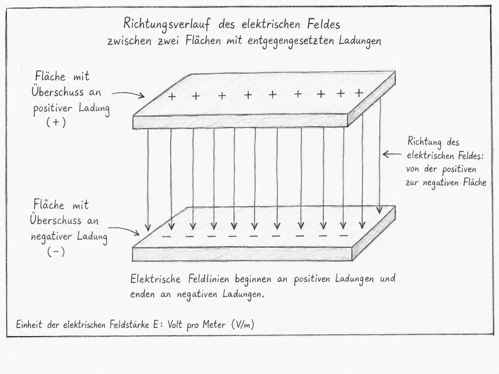
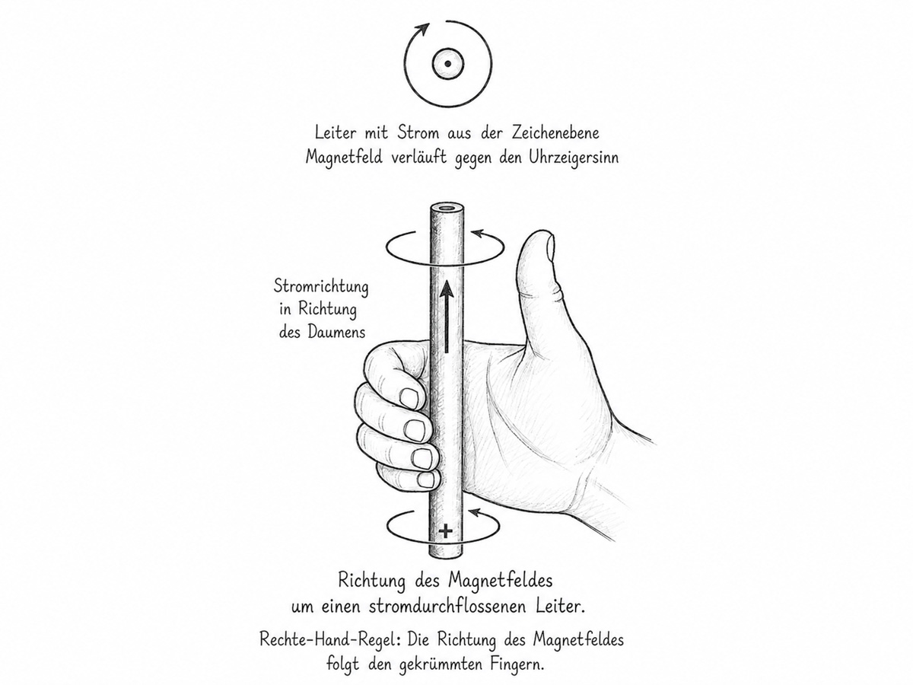
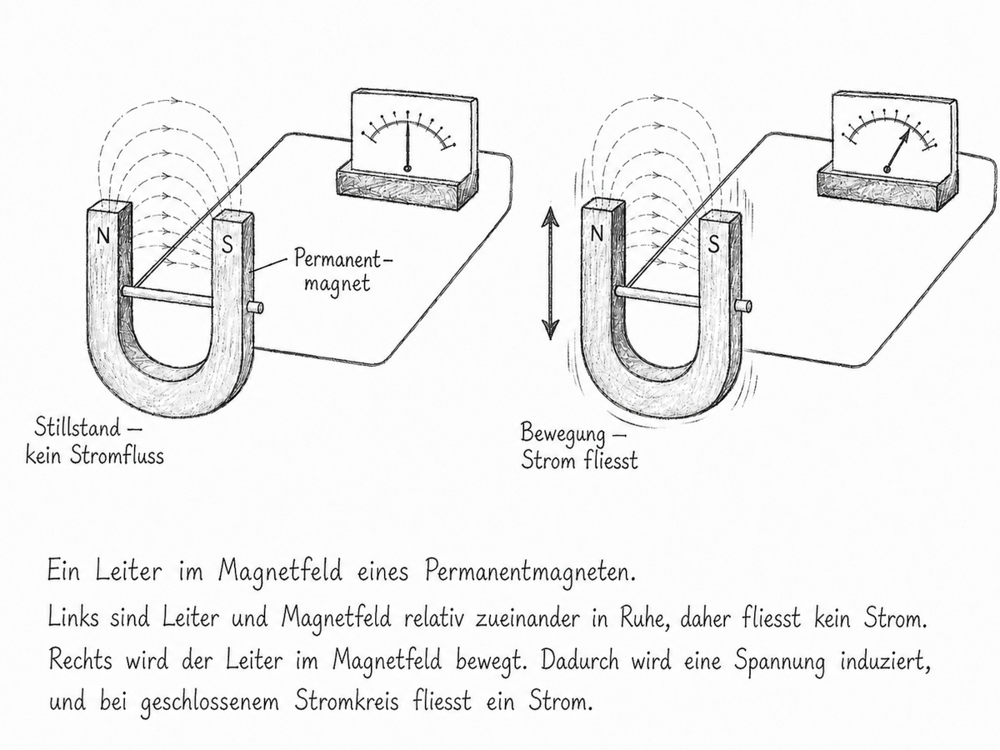
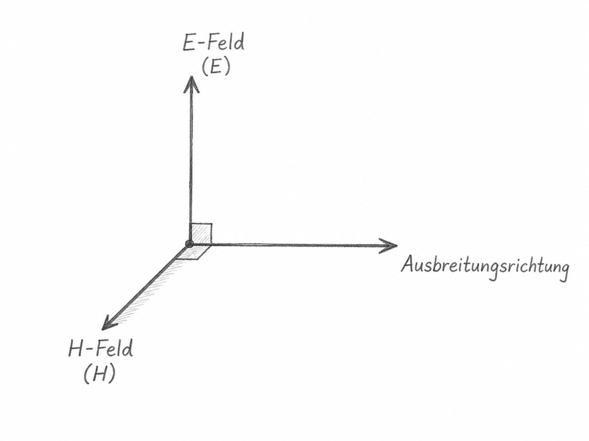

# Kapitel 3: Elektromagnetische Wellen

## Lernziele

Nach diesem Kapitel solltest du:

- erklären können, was ein elektrisches Feld ist
- erklären können, was ein magnetisches Feld ist
- den Zusammenhang zwischen elektrischem Strom und Magnetfeld verstehen
- die Rechte-Hand-Regel für einen geraden stromdurchflossenen Leiter anwenden können
- statische und zeitlich veränderliche Felder unterscheiden können
- das Grundprinzip der elektromagnetischen Induktion erklären können
- erklären können, was eine elektromagnetische Welle ist
- verstehen, weshalb eine Funkantenne elektromagnetische Energie abstrahlen kann
- elektrische Feldstärke, magnetische Feldstärke und Ausbreitungsrichtung unterscheiden können
- Nahfeld und Fernfeld grundsätzlich unterscheiden können
- die Polarisation einer Funkwelle erklären können
- verstehen, weshalb Sende- und Empfangsvorgang einer Antenne grundsätzlich umkehrbar sind
- Funkwellen und sichtbares Licht physikalisch einordnen können

> **Hinweis zu HB3 und HB9:**
> Elektrische Felder, magnetische Felder und Funktheorie gehören gemäss BAKOM zum technischen Prüfungsstoff. Für HB3 sind die technischen und rechnerischen Fragen weniger komplex als für HB9. Die Kennzeichnung **HB9-Vertiefung** dient in diesem Lehrwerk als Lernhilfe.

## Formelzeichen und Symbole

<table>
<thead>
<tr>
<th>Zeichen</th>
<th>Name</th>
<th>Bedeutung</th>
<th>Einheit</th>
</tr>
</thead>
<tbody>
<tr>
<td>\(E\)</td>
<td>E</td>
<td>elektrische Feldstärke</td>
<td>V/m</td>
</tr>
<tr>
<td>\(H\)</td>
<td>H</td>
<td>magnetische Feldstärke</td>
<td>A/m</td>
</tr>
<tr>
<td>\(U\)</td>
<td>U</td>
<td>elektrische Spannung</td>
<td>V</td>
</tr>
<tr>
<td>\(I\)</td>
<td>I</td>
<td>elektrischer Strom</td>
<td>A</td>
</tr>
<tr>
<td>\(f\)</td>
<td>f</td>
<td>Frequenz</td>
<td>Hz</td>
</tr>
<tr>
<td>\(\lambda\)</td>
<td>Lambda</td>
<td>Wellenlänge</td>
<td>m</td>
</tr>
<tr>
<td>\(c\)</td>
<td>c</td>
<td>Ausbreitungsgeschwindigkeit</td>
<td>m/s</td>
</tr>
</tbody>
</table>

Der griechische Buchstabe:

\[
\lambda
\]

wird **Lambda** ausgesprochen und bezeichnet die Wellenlänge.

## Der rote Faden

Aus Kapitel 1 kennen wir:

**Spannung**

und:

**Strom**

In diesem Kapitel gehen wir einen Schritt weiter.

Eine elektrische Spannung beziehungsweise elektrische Ladung steht mit einem:

**elektrischen Feld**

in Verbindung.

Ein elektrischer Strom erzeugt ein:

**magnetisches Feld**

Verändern sich elektrische Ladungs- und Stromverteilungen mit der Zeit, entstehen ebenfalls zeitlich veränderliche elektrische und magnetische Felder.

Bei einer geeigneten räumlichen Anordnung können diese Felder Energie von einer Antenne weg transportieren.

Dann entsteht eine:

**elektromagnetische Welle**

Genau eine solche elektromagnetische Welle nennen wir im Funkbereich:

**Funkwelle**

---

# Was ist ein Feld?

Ein Feld beschreibt eine physikalische Wirkung, die jedem Punkt eines Raumes eine bestimmte Grösse und Richtung zuordnet.

Man kann ein Feld nicht direkt sehen.

Seine Wirkung kann jedoch beobachtet oder gemessen werden.

Für die Funktechnik sind besonders wichtig:

- elektrische Felder
- magnetische Felder

Beide gehören zum:

**elektromagnetischen Feld**

---

# Elektrische Felder

Ein elektrisches Feld entsteht durch elektrische Ladungen.

Zwischen zwei Punkten mit unterschiedlichem elektrischem Potential kann ebenfalls ein elektrisches Feld bestehen.

Ein einfaches Beispiel ist das Feld zwischen zwei geladenen Metallplatten.

Die Richtung des elektrischen Feldes ist definitionsgemäss:

**von positiver zu negativer Ladung**

gerichtet.

**Abbildung 3-4:** Vereinfachte Darstellung eines elektrischen Feldes zwischen positiver und negativer Ladung. Die Feldrichtung ist definitionsgemäss von Plus nach Minus gerichtet.

## Elektrische Feldstärke

Die Stärke eines elektrischen Feldes wird durch die:

**elektrische Feldstärke**

beschrieben.

Das Formelzeichen lautet:

\[
E
\]

Die Einheit ist:

\[
\mathrm{V/m}
\]

Volt pro Meter.

Bei einem idealisierten homogenen Feld zwischen zwei parallelen Platten gilt:

\[
E=\frac{U}{d}
\]

Dabei gilt:

- \(E\) = elektrische Feldstärke
- \(U\) = Spannung zwischen den Platten
- \(d\) = Abstand der Platten

Diese Beziehung ist auch in der aktuellen BAKOM-Formelsammlung enthalten.

---

# Beispiel elektrische Feldstärke

Zwischen zwei idealisierten parallelen Platten liegen:

\[
U=100\ \mathrm{V}
\]

Der Abstand beträgt:

\[
d=0{,}02\ \mathrm{m}
\]

Dann:

\[
E = \frac{100}{0{,}02}
\]

\[
E = 5,000\ \mathrm{V/m}
\]

Das Beispiel beschreibt ein vereinfachtes homogenes Feld.

Bei realen Antennen sind die Feldverhältnisse wesentlich komplexer.

---

# Magnetische Felder

Ein elektrischer Strom erzeugt ein magnetisches Feld.

Fliesst Strom durch einen geraden Leiter, verlaufen die magnetischen Feldlinien kreisförmig um diesen Leiter.

**Abbildung 3-3:** Magnetfeld um einen stromdurchflossenen Leiter. Die Rechte-Hand-Regel zeigt den Zusammenhang zwischen technischer Stromrichtung und Richtung des Magnetfeldes.

## Rechte-Hand-Regel

Umfasst man einen geraden stromdurchflossenen Leiter mit der rechten Hand:

**Daumen**

→ zeigt in Richtung der technischen Stromrichtung

**gekrümmte Finger**

→ zeigen die Richtung des Magnetfeldes

Diese Regel gilt für die technische Stromrichtung, die wir bereits in Kapitel 1 kennengelernt haben.

---

# Magnetische Feldstärke

Die magnetische Feldstärke wird mit:

\[
H
\]

bezeichnet.

Die Einheit lautet:

\[
\mathrm{A/m}
\]

Ampere pro Meter.

Bei einem einzelnen geraden Leiter gilt grundsätzlich:

**grösserer Strom**

→ stärkeres Magnetfeld

mit zunehmendem Abstand vom Leiter wird das Feld schwächer.

---

# Elektrisches Feld und magnetisches Feld nicht verwechseln

<table>
<thead>
<tr>
<th>Elektrisches Feld</th>
<th>Magnetisches Feld</th>
</tr>
</thead>
<tbody>
<tr>
<td>steht mit elektrischen Ladungen und Spannungen in Verbindung</td>
<td>entsteht unter anderem durch elektrische Ströme</td>
</tr>
<tr>
<td>Feldstärke \(E\)</td>
<td>Feldstärke \(H\)</td>
</tr>
<tr>
<td>Einheit V/m</td>
<td>Einheit A/m</td>
</tr>
<tr>
<td>Feldrichtung bei positiven und negativen Ladungen von Plus nach Minus</td>
<td>Feldlinien um einen geraden stromdurchflossenen Leiter verlaufen kreisförmig</td>
</tr>
</tbody>
</table>

Beide Felder sind unterschiedliche Aspekte des elektromagnetischen Feldes.

---

# Statische Felder

Ein elektrisches oder magnetisches Feld bedeutet noch nicht automatisch, dass eine Funkwelle entsteht.

## Statisches elektrisches Feld

Eine ruhende elektrische Ladungsverteilung kann ein zeitlich konstantes elektrisches Feld erzeugen.

Beispiel:

**elektrostatisch aufgeladener Körper**

## Statisches magnetisches Feld

Ein Permanentmagnet erzeugt ein zeitlich weitgehend konstantes Magnetfeld.

Auch ein konstanter Gleichstrom erzeugt nach dem Einschwingvorgang ein zeitlich konstantes Magnetfeld.

Solche statischen Felder bilden für sich allein keine sich frei ausbreitende Funkwelle.

---

# Zeitlich veränderliche Felder

Für die Funktechnik sind vor allem:

**zeitlich veränderliche elektrische und magnetische Felder**

entscheidend.

Ändert sich beispielsweise ein elektrischer Strom, verändert sich auch das dazugehörige Magnetfeld.

Ein veränderliches Magnetfeld kann wiederum elektrische Spannungen hervorrufen.

Diese Erscheinung nennt man:

**elektromagnetische Induktion**

---

# Elektromagnetische Induktion

Wird der magnetische Fluss durch eine Leiterschleife verändert, kann in der Schleife eine elektrische Spannung induziert werden.

Eine Änderung kann beispielsweise entstehen, indem:

- sich das Magnetfeld verändert
- sich der Leiter im Magnetfeld bewegt
- sich die Lage zwischen Leiter und Magnetfeld verändert

**Abbildung 3-2:** Bewegung beziehungsweise Änderung eines Leiters im Magnetfeld kann eine elektrische Spannung induzieren. Dieses Grundprinzip begegnet uns beispielsweise bei Generatoren und Transformatoren.

## Wo begegnet uns Induktion?

Das Grundprinzip wird unter anderem verwendet bei:

- Generatoren
- Transformatoren
- Spulen
- induktiven Sensoren

Für den Amateurfunk ist besonders wichtig:

> **Elektrische und magnetische Vorgänge sind miteinander gekoppelt.**

Die vollständige mathematische Beschreibung erfolgt durch die Maxwell-Gleichungen.

Für die HB3- und HB9-Grundlagen müssen diese Gleichungen nicht hergeleitet werden.

---

# Was ist eine elektromagnetische Welle?

Eine Funkwelle ist eine:

**elektromagnetische Welle**

Sie besitzt ein zeitlich veränderliches elektrisches Feld und ein damit gekoppeltes zeitlich veränderliches magnetisches Feld.

Im Fernfeld einer Funkantenne stehen:

- elektrisches Feld \(E\)
- magnetisches Feld \(H\)
- Ausbreitungsrichtung

jeweils senkrecht aufeinander.

**Abbildung 3-1:** Im Fernfeld stehen elektrisches Feld \(E\), magnetisches Feld \(H\) und Ausbreitungsrichtung einer elektromagnetischen Welle senkrecht aufeinander.

Diese drei Richtungen darf man nicht miteinander verwechseln.

---

# Ein wichtiges Missverständnis

Manchmal wird vereinfacht erklärt:

> Ein elektrisches Feld erzeugt ein magnetisches Feld, dieses erzeugt wieder ein elektrisches Feld und so weiter.

Dieses Bild ist für ein erstes Verständnis verlockend, aber physikalisch zu grob.

Elektrisches und magnetisches Feld einer Funkwelle sind nicht zwei voneinander unabhängige Erscheinungen, die sich abwechselnd neu erzeugen.

Sie sind:

**gemeinsam Bestandteile desselben elektromagnetischen Feldes**

und werden gemeinsam durch die Maxwell-Gleichungen beschrieben.

---

# Wie entsteht eine Funkwelle?

Ein Funksender erzeugt eine hochfrequente Wechselspannung beziehungsweise einen hochfrequenten Wechselstrom.

Diese Hochfrequenzenergie wird über eine Speiseleitung zur Antenne geführt.

In der Antenne entstehen zeitlich veränderliche:

- Spannungen
- Ströme
- Ladungsverteilungen

Dadurch entstehen ebenfalls zeitlich veränderliche elektrische und magnetische Felder.

Ist die Antennenstruktur für die betreffende Frequenz geeignet, kann ein Teil der zugeführten Energie als elektromagnetische Welle in den freien Raum abgestrahlt werden.

---

# Die Antenne als Übergang

Eine Antenne verbindet zwei Bereiche:

**leitungsgebundene Hochfrequenzenergie**

mit:

**elektromagnetischer Energie im freien Raum**

Beim Senden erfolgt der Übergang:

**Sender → Leitung → Antenne → elektromagnetische Welle**

Beim Empfang:

**elektromagnetische Welle → Antenne → Leitung → Empfänger**

Dieses Wandlerprinzip wird im nächsten Kapitel ausführlich behandelt.

---

# Warum strahlt nicht jeder Leiter gleich gut?

Jeder zeitlich veränderliche Strom erzeugt zeitlich veränderliche Felder.

Trotzdem ist nicht jeder stromdurchflossene Leiter automatisch eine gute Antenne.

Entscheidend sind unter anderem:

- räumliche Stromverteilung
- Leiterlänge
- Leiterabstand
- Rückstrompfad
- Verhältnis der Abmessungen zur Wellenlänge
- Umgebung

Ein wesentlicher Unterschied besteht beispielsweise zwischen:

**Speiseleitung**

und:

**Antenne**

---

# Warum soll eine Speiseleitung möglichst wenig strahlen?

Nehmen wir eine Zweidrahtleitung.

Hinleiter und Rückleiter liegen dicht nebeneinander.

Die Ströme fliessen in entgegengesetzte Richtungen.

Ist ihr Abstand klein gegenüber der Wellenlänge, können sich die von ihnen erzeugten Fernfelder weitgehend gegenseitig kompensieren.

Eine gut aufgebaute Speiseleitung soll deshalb die HF-Energie:

**transportieren**

und nicht bereits unterwegs unnötig:

**abstrahlen**

Bei einer Antenne wird die Stromverteilung dagegen gezielt so gestaltet, dass elektromagnetische Energie wirksam abgestrahlt werden kann.

---

# Senden und Empfangen

Das Wirkprinzip einer Antenne ist grundsätzlich umkehrbar.

Beim Senden:

**elektrisches HF-Signal**

→ elektromagnetische Welle

Beim Empfang:

**elektromagnetische Welle**

→ elektrisches HF-Signal

Trifft eine Funkwelle auf eine Empfangsantenne, wirkt ihr elektromagnetisches Feld auf die Ladungsträger im Leiter.

Dadurch entsteht an der Antenne eine hochfrequente Spannung und bei geschlossenem Stromkreis ein entsprechender Strom.

Der Empfänger verarbeitet dieses meist sehr kleine Signal weiter.

## Merksatz

> **Eine geeignete Antenne kann grundsätzlich sowohl senden als auch empfangen.**

---

# Ausbreitungsgeschwindigkeit

Elektromagnetische Wellen breiten sich im Vakuum mit Lichtgeschwindigkeit aus.

Es gilt exakt:

\[
c = 299,792,458\ \mathrm{m/s}
\]

Für praktische Funkberechnungen verwenden wir:

\[
c
\approx
300,000,000\ \mathrm{m/s}
\]

oder:

\[
c
\approx
3{,}00\times10^8\ \mathrm{m/s}
\]

Dieser Zusammenhang wurde bereits in Kapitel 2 behandelt.

---

# Funkwellen und Licht

Sichtbares Licht ist ebenfalls elektromagnetische Strahlung.

Auch:

- Radiowellen
- Mikrowellen
- Infrarotstrahlung
- sichtbares Licht
- Ultraviolettstrahlung
- Röntgenstrahlung
- Gammastrahlung

gehören zum elektromagnetischen Spektrum.

Sie unterscheiden sich insbesondere durch:

- Frequenz
- Wellenlänge
- damit verbundene Wechselwirkungen mit Materie

Funkwellen und sichtbares Licht breiten sich im Vakuum mit derselben Geschwindigkeit aus.

---

# Frequenz und Wellenlänge

Aus Kapitel 2 kennen wir:

\[
c=f\cdot\lambda
\]

beziehungsweise:

\[
\lambda=\frac{c}{f}
\]

Für praktische Amateurfunkrechnungen gilt näherungsweise:

\[
\lambda,[\mathrm{m}] \approx \frac{300}{f,[\mathrm{MHz}]}
\]

Die Wellenlänge wird für Antennen entscheidend, weil ihre Abmessungen häufig in Bruchteilen von:

\[
\lambda
\]

angegeben werden.

---

# Die Frequenz ändert sich bei normaler Ausbreitung nicht einfach

Wird ein Funksignal schwächer, bedeutet dies nicht, dass seine Frequenz deshalb kleiner wird.

Eine elektromagnetische Welle kann:

- abgeschwächt
- reflektiert
- gebrochen
- gestreut
- gedämpft

werden.

Die ursprüngliche Frequenz bleibt dabei grundsätzlich erhalten.

Zusätzliche physikalische Effekte wie der Dopplereffekt können allerdings eine Frequenzverschiebung verursachen.

Darauf gehen wir später ein.

---

# Polarisation

Eine Funkwelle besitzt eine:

**Polarisation**

Die Polarisation wird nach der Orientierung des:

**elektrischen Feldes \(E\)**

bezeichnet.

Das ist ein sehr wichtiger Prüfungs- und Praxisbegriff.

## Vertikale Polarisation

Ist das elektrische Feld vertikal ausgerichtet, spricht man von:

**vertikaler Polarisation**

## Horizontale Polarisation

Ist das elektrische Feld horizontal ausgerichtet, spricht man von:

**horizontaler Polarisation**

## Zirkulare Polarisation

Bei zirkularer Polarisation dreht sich die Richtung des elektrischen Feldvektors während der Ausbreitung.

## Elliptische Polarisation

Die allgemeinere Form einer solchen Drehung ist die:

**elliptische Polarisation**

Die Polarisation behandeln wir in Kapitel 5 nochmals ausführlicher.

---

# Polarisation und Antennen

Sende- und Empfangsantenne arbeiten besonders wirksam zusammen, wenn ihre Polarisation zueinander passt.

Beispielsweise:

**vertikal → vertikal**

oder:

**horizontal → horizontal**

Bei zwei idealen linear polarisierten Antennen, die exakt um 90° gegeneinander verdreht sind, entsteht theoretisch eine sehr starke Polarisationsdämpfung.

In der Praxis können:

- Reflexionen
- Streuung
- Mehrwegeausbreitung

die Polarisation jedoch verändern.

---

# Polarisation wird nach E bezeichnet

Das sollte sicher sitzen.

Nicht:

**Richtung des Magnetfeldes**

sondern:

**Richtung des elektrischen Feldes**

bestimmt die Bezeichnung der Polarisation.

## Nicht verwechseln

<table>
<thead>
<tr>
<th>Begriff</th>
<th>Bezug</th>
</tr>
</thead>
<tbody>
<tr>
<td>Polarisation</td>
<td>Richtung beziehungsweise zeitliche Orientierung des elektrischen Feldes \(E\)</td>
</tr>
<tr>
<td>magnetisches Feld \(H\)</td>
<td>steht im Fernfeld senkrecht zu \(E\)</td>
</tr>
<tr>
<td>Ausbreitungsrichtung</td>
<td>steht im Fernfeld senkrecht zu \(E\) und \(H\)</td>
</tr>
</tbody>
</table>

---

# Nahfeld und Fernfeld

In unmittelbarer Nähe einer Antenne sind die Feldverhältnisse komplizierter als in grosser Entfernung.

Deshalb unterscheidet man grundsätzlich:

**Nahfeld**

und:

**Fernfeld**

---

# Nahfeld

Im Nahfeld wird das elektromagnetische Feld stark durch:

- Antennenform
- Antennenabmessungen
- Strom- und Spannungsverteilung
- Abstand von der Antenne

bestimmt.

Elektrische und magnetische Feldanteile können sich dort anders zueinander verhalten als in einer frei laufenden Fernfeldwelle.

Deshalb darf man die einfache Fernfelddarstellung nicht unmittelbar auf jeden Punkt direkt neben einer Antenne übertragen.

---

# Fernfeld

In ausreichender Entfernung von der Antenne hat sich eine sich ausbreitende elektromagnetische Welle ausgebildet.

Dort stehen:

\[
E
\]

\[
H
\]

und die:

**Ausbreitungsrichtung**

senkrecht aufeinander.

Im Fernfeld kann die Welle lokal näherungsweise wie eine ebene elektromagnetische Welle betrachtet werden.

---

# Wo beginnt das Fernfeld?

Es gibt keine einzelne feste Entfernung, die für jede Antenne gleicherweise gilt.

Die Übergänge hängen unter anderem ab von:

- Wellenlänge
- Antennenabmessungen
- Antennenform
- Beobachtungsrichtung

Deshalb wäre die Aussage:

**Das Fernfeld beginnt immer nach einer bestimmten Anzahl Meter**

falsch.

Für bestimmte Berechnungsmodelle werden vereinfachte Bedingungen verwendet.

Diese behandeln wir später bei NIS und Sicherheitsberechnungen.

---

# Funkwellen transportieren Energie

Eine elektromagnetische Welle transportiert Energie von der Sendeantenne weg.

Der Sender stellt die elektrische Leistung bereit.

Die Antenne wandelt einen Teil davon in abgestrahlte elektromagnetische Leistung um.

Bei freier räumlicher Ausbreitung verteilt sich diese Energie mit zunehmender Entfernung über eine immer grössere Fläche.

Deshalb wird das empfangbare Feld mit wachsender Entfernung schwächer.

---

# Warum kann man trotzdem sehr weit funken?

Die empfangene Signalstärke hängt nicht nur von der geometrischen Entfernung ab.

Weitere wichtige Faktoren sind:

- Sendeleistung
- Antennengewinn
- Antennenrichtung
- Frequenz
- Gelände
- Atmosphäre
- Ionosphäre
- Reflexionen
- Empfängerempfindlichkeit
- Störpegel

Deshalb kann eine Kurzwellenstation unter günstigen Bedingungen über Tausende Kilometer gehört werden.

Die eigentlichen Ausbreitungsmechanismen behandeln wir in Kapitel 8.

---

# Reflexion

Elektromagnetische Wellen können an Grenzflächen und Gegenständen reflektiert werden.

Wie stark dies geschieht, hängt unter anderem ab von:

- Material
- Leitfähigkeit
- Frequenz
- Wellenlänge
- Einfallswinkel
- Grösse des Objekts

Metallische Flächen können Funkwellen besonders stark beeinflussen.

Dieses Prinzip wird beispielsweise bei:

- Reflektoren von Richtantennen
- Parabolantennen
- Radar

genutzt.

---

# Brechung

Ändern sich die Ausbreitungsbedingungen eines Mediums räumlich, kann sich die Ausbreitungsrichtung einer Welle verändern.

Diese Richtungsänderung wird als:

**Brechung**

bezeichnet.

Für den Amateurfunk spielt sie beispielsweise bei:

- Atmosphäre
- Troposphäre
- Ionosphäre

eine wichtige Rolle.

Die Details folgen in Kapitel 8.

---

# Beugung

Funkwellen können unter bestimmten Bedingungen auch in geometrische Schattenbereiche gelangen.

Eine Welle kann sich beispielsweise an:

- Geländekanten
- Hindernissen

teilweise in den Schattenraum hinein ausbreiten.

Diese Erscheinung wird als:

**Beugung**

bezeichnet.

Wie stark sie ausgeprägt ist, hängt stark vom Verhältnis zwischen:

- Wellenlänge
- Grösse des Hindernisses

ab.

---

# Streuung

Trifft eine elektromagnetische Welle auf unregelmässige Strukturen oder Teilchen, kann Energie in unterschiedliche Richtungen verteilt werden.

Dies bezeichnet man als:

**Streuung**

Streuung spielt später beispielsweise bei bestimmten VHF- und UHF-Ausbreitungsarten eine Rolle.

---

# Reflexion, Brechung, Beugung und Streuung nicht verwechseln

| Erscheinung | Grundidee |
| --- | --- |
| Reflexion | Welle wird zurückgeworfen |
| Brechung | Ausbreitungsrichtung verändert sich durch veränderte Ausbreitungsbedingungen |
| Beugung | Welle gelangt teilweise um Hindernisse beziehungsweise Kanten |
| Streuung | Energie wird in verschiedene Richtungen verteilt |

Diese Begriffe begegnen uns im Kapitel über Funkwellenausbreitung erneut.

---

# Ein Funke erzeugt Funkstörungen

Eine schnelle elektrische Entladung erzeugt einen kurzen Stromimpuls.

Ein sehr kurzer Impuls enthält viele Frequenzanteile.

Dadurch kann elektromagnetische Energie über einen grossen Frequenzbereich entstehen.

Ein typisches Beispiel ist:

**Knacken im Radio beim Schalten oder bei einem Zündfunken**

Das ist jedoch etwas völlig anderes als ein sauber erzeugtes Amateurfunksignal.

---

# Sender erzeugen kontrollierte Signale

Für Funkkommunikation möchte man keine breitbandigen zufälligen Impulse erzeugen.

Ein Sender erzeugt deshalb ein kontrolliertes Hochfrequenzsignal mit:

- bestimmter Frequenz
- definierter Modulation
- begrenzter Bandbreite

Dieses Signal wird anschliessend über die Antenne abgestrahlt.

Die genaue Erzeugung solcher Signale behandeln wir in den Kapiteln über Sender und Modulation.

---

# Drei Dinge, die man nicht verwechseln darf

| Begriff | Bedeutung |
| --- | --- |
| elektrisches Feld | Feld im Zusammenhang mit elektrischen Ladungen und Spannungen |
| magnetisches Feld | Feld im Zusammenhang unter anderem mit elektrischen Strömen |
| elektromagnetische Welle | sich ausbreitendes elektromagnetisches Feld, das Energie transportiert |

Und:

| Begriff | Bedeutung |
| --- | --- |
| statisches Feld | zeitlich unveränderliches beziehungsweise annähernd konstantes Feld |
| Nahfeld | Bereich nahe der Antenne mit komplexen Feldverhältnissen |
| Fernfeld | Bereich der sich ausbreitenden elektromagnetischen Welle |

Und:

<table>
<thead>
<tr>
<th>Begriff</th>
<th>Bedeutung</th>
</tr>
</thead>
<tbody>
<tr>
<td>\(E\)</td>
<td>elektrische Feldstärke</td>
</tr>
<tr>
<td>\(H\)</td>
<td>magnetische Feldstärke</td>
</tr>
<tr>
<td>Polarisation</td>
<td>wird nach der Orientierung von \(E\) bezeichnet</td>
</tr>
</tbody>
</table>

---

# Lernschema

Wenn eine Aufgabe elektromagnetische Felder betrifft, gehe in dieser Reihenfolge vor:

1. **Elektrisches oder magnetisches Feld?**
2. **Statisch oder zeitlich veränderlich?**
3. **Fliesst ein Strom?**
4. **Ändert sich das Feld mit der Zeit?**
5. **Geht es um Induktion oder um eine sich ausbreitende Welle?**
6. **Nahfeld oder Fernfeld?**
7. **Welche Richtung besitzt \(E\)?**
8. **Welche Richtung besitzt \(H\)?**
9. **Welche Richtung besitzt die Ausbreitung?**
10. **Welche Polarisation liegt vor?**

---

# Die wichtigsten Zusammenhänge auf einen Blick

Elektrische Feldstärke im idealisierten homogenen Feld:

\[
E=\frac{U}{d}
\]

Zusammenhang zwischen Frequenz und Wellenlänge:

\[
c=f\lambda
\]

Wellenlänge:

\[
\lambda=\frac{c}{f}
\]

Praktische Funknäherung:

\[
\lambda,[\mathrm{m}] \approx \frac{300}{f,[\mathrm{MHz}]}
\]

Im Fernfeld gilt geometrisch:

**\(E\), \(H\) und Ausbreitungsrichtung stehen senkrecht aufeinander.**

---

# Merksätze

**Eine Funkwelle ist eine elektromagnetische Welle.**

**Elektrische Ladungen beziehungsweise Spannungen stehen mit elektrischen Feldern in Verbindung.**

**Elektrischer Strom erzeugt ein magnetisches Feld.**

**Die Rechte-Hand-Regel verbindet technische Stromrichtung und Magnetfeldrichtung.**

**Ein zeitlich konstantes Feld allein ist noch keine Funkwelle.**

**Zeitlich veränderliche elektrische und magnetische Vorgänge sind miteinander gekoppelt.**

**Eine Änderung des magnetischen Flusses kann eine elektrische Spannung induzieren.**

**Elektrisches und magnetisches Feld bilden gemeinsam das elektromagnetische Feld.**

**Im Fernfeld stehen \(E\), \(H\) und Ausbreitungsrichtung senkrecht aufeinander.**

**Die Polarisation wird nach der Richtung des elektrischen Feldes bezeichnet.**

**Eine Antenne koppelt Hochfrequenzenergie zwischen einem Leitungssystem und dem freien Raum.**

**Eine geeignete Antenne kann grundsätzlich sowohl senden als auch empfangen.**

**Funkwellen und sichtbares Licht sind elektromagnetische Wellen.**

**Nahfeld und Fernfeld sind nicht dasselbe.**

---

# Selbstkontrolle

Versuche die Fragen zuerst ohne Nachschlagen zu beantworten.

1. Was erzeugt ein elektrisches Feld?
2. In welche Richtung ist ein elektrisches Feld definitionsgemäss zwischen positiver und negativer Ladung gerichtet?
3. Welche Einheit besitzt die elektrische Feldstärke?
4. Was erzeugt ein elektrischer Strom?
5. Wie verlaufen die magnetischen Feldlinien um einen geraden stromdurchflossenen Leiter?
6. Wozu dient die Rechte-Hand-Regel?
7. Erzeugt ein Permanentmagnet automatisch eine Funkwelle?
8. Warum genügt ein konstanter Gleichstrom nicht zur kontinuierlichen Abstrahlung einer Funkwelle?
9. Was bedeutet elektromagnetische Induktion grundsätzlich?
10. Was ist eine Funkwelle?
11. Wie stehen \(E\), \(H\) und Ausbreitungsrichtung im Fernfeld zueinander?
12. Nach welcher Feldrichtung wird die Polarisation einer Funkwelle bezeichnet?
13. Welche Polarisation besitzt eine Welle mit vertikalem elektrischem Feld?
14. Was ist der wesentliche Unterschied zwischen Nahfeld und Fernfeld?
15. Kann dieselbe Antenne grundsätzlich zum Senden und Empfangen verwendet werden?
16. Was unterscheidet Funkwellen und sichtbares Licht physikalisch hauptsächlich?
17. Warum strahlt eine symmetrische Zweidraht-Speiseleitung vergleichsweise wenig, wenn Hin- und Rückleiter nahe beieinanderliegen?
18. Was ist der Unterschied zwischen Reflexion und Brechung?

## Antworten

1. Elektrische Ladungen beziehungsweise elektrische Potentialunterschiede erzeugen elektrische Felder.
2. Von Plus nach Minus.
3. \(\mathrm{V/m}\)
4. Ein magnetisches Feld.
5. Kreisförmig um den Leiter.
6. Zur Bestimmung der Richtung des Magnetfeldes um einen stromdurchflossenen Leiter aus der technischen Stromrichtung.
7. **Nein.** Er erzeugt ein statisches Magnetfeld.
8. Weil nach dem Einschwingvorgang Strom und Magnetfeld zeitlich konstant sind. Für eine kontinuierliche elektromagnetische Abstrahlung sind zeitlich veränderliche Ladungs- und Stromverteilungen erforderlich.
9. Eine Änderung des magnetischen Flusses kann eine elektrische Spannung hervorrufen.
10. Eine sich ausbreitende elektromagnetische Welle im Funkfrequenzbereich.
11. Sie stehen jeweils senkrecht aufeinander.
12. Nach der Richtung des elektrischen Feldes \(E\).
13. Vertikale Polarisation.
14. Im Nahfeld sind die Feldverhältnisse stark von Antenne und Geometrie abhängig. Im Fernfeld hat sich eine sich ausbreitende elektromagnetische Welle ausgebildet.
15. **Ja.**
16. Vor allem durch ihre Frequenz beziehungsweise Wellenlänge und die daraus resultierende Wechselwirkung mit Materie.
17. Weil die entgegengesetzten Ströme nahe beieinanderliegen und sich ihre Fernfeldanteile weitgehend gegenseitig kompensieren können.
18. Bei Reflexion wird eine Welle zurückgeworfen. Bei Brechung ändert sie ihre Ausbreitungsrichtung aufgrund veränderter Ausbreitungsbedingungen.

---

# Prüfungsbezug HB3 und HB9

Die aktuellen BAKOM-Prüfungsvorschriften nennen im Bereich Elektrizität, Elektromagnetismus und Funktheorie ausdrücklich:

- elektrische Felder
- magnetische Felder

Zusätzlich gehört:

- Wellenausbreitung

als eigener technischer Prüfungsbereich dazu.

Die aktuelle BAKOM-Formelsammlung enthält unter anderem die elektrische Feldstärke:

\[
E=\frac{U}{d}
\]

für das idealisierte Feld eines Plattenkondensators.

Für HB3 und HB9 sind insbesondere wichtig:

- elektrisches Feld
- magnetisches Feld
- Zusammenhang zwischen Strom und Magnetfeld
- Rechte-Hand-Regel
- statische und zeitlich veränderliche Felder
- Grundprinzip elektromagnetischer Induktion
- Aufbau einer elektromagnetischen Welle
- Orientierung von \(E\) und \(H\)
- Polarisation
- Zusammenhang zwischen Frequenz und Wellenlänge
- Grundverständnis von Nahfeld und Fernfeld

Für HB9 sollte das Verständnis dieser Zusammenhänge sicher genug sein, um sie auch auf Antennen, Speiseleitungen, Induktion und einfache Feldberechnungen übertragen zu können.

# Navigation

[← Kapitel 2: Frequenz, Periodendauer und Wellenlänge](02-frequenz-wellenlaenge.md)

[↑ Zurück zum Inhaltsverzeichnis](einfuehrung.md)

[Kapitel 4: Grundlagen der Antennentechnik →](04-antennen-grundlagen.md)

---

*© 1984 bis 2026 FerienBSD aka Marcel Sauder. Lizenz: [CC BY 4.0](https://creativecommons.org/licenses/by/4.0/deed.de). Du darfst die Inhalte teilen und bearbeiten, wenn du den Urheber nennst.*
